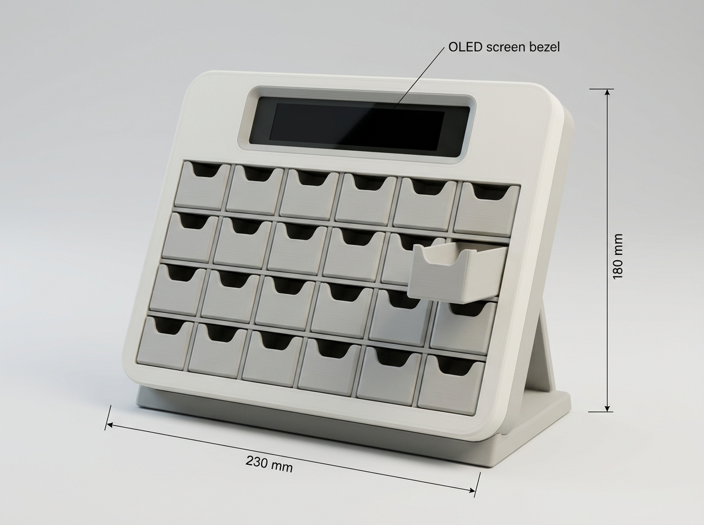

# BẢN VẼ CHI TIẾT CÁC LINH KIỆN ĐỂ DỰNG HÌNH 3D VÀ LẮP RÁP HỘP THUỐC CALENDIA+
## (Thiết Kế Tham Số CAD • Bóc Tách 8 Part Cơ Khí • Ma Trận 28 Ngăn 7×4 • Tối Ưu In 3D Nhựa PETG • Sơ Đồ Đấu Nối 11 Linh Kiện)

---

## 1. Tổng Quan Kích Thước Hình Học & Phân Vùng Cấu Trúc

**CalenDIA+** được thiết kế dưới dạng thiết bị lịch nhắc thuốc thông minh để bàn (Smart Desktop Pill Calendar Console). Sản phẩm kết hợp giữa bảng điều khiển nghiêng công thái học, màn hình hiển thị OLED trực quan ở đỉnh, và ma trận 28 ngăn kéo mini độc lập tương ứng với **7 ngày trong tuần × 4 cữ uống mỗi ngày (Sáng – Trưa – Chiều – Tối)**.

### Hình Ảnh Mô Hình In 3D Nhựa PETG (Nguyên Bản Cơ Khí, Kèm Kích Thước Tổng Thể):

*(Ảnh hiển thị mẫu in 3D thực tế bằng nhựa PETG: Chiều dài 230 mm, Chiều cao 180 mm, cụm 28 ngăn kéo cơ khí và hốc Bezel gắn màn hình OLED)*

```
◄─────────────────────────── W = 230.0 mm ───────────────────────────►
┌───────────────────────────────────────────────────────────────────┐ ── Part 1 (Front Bezel)
│  ╭─────────────────────────────────────────────────────────────╮  │ 
│  │   DIA+ 142 mg/dL  •  BA ƠI ĐẾN GIỜ UỐNG THUỐC (OLED Display)│  │ ── Part 5 (OLED Bezel)
│  ╰─────────────────────────────────────────────────────────────╯  │
│    T.HAI    T.BA     T.TƯ    T.NĂM    T.SÁU    T.BẢY     CN       │ 
│   ┌─────┐  ┌─────┐  ┌─────┐  ┌─────┐  ┌─────┐  ┌─────┐  ┌─────┐   │ 
│SÁNG [ 01 ]  [ 02 ]   [ 03 ]   [ 04 ]   [ 05 ]   [ 06 ]   [ 07 ]   │
│   ├─────┤  ├─────┤  ├─────┤  ├─────┤  ├─────┤  ├─────┤  ├─────┤   │
│TRƯA [ 08 ]  [ 09 ]   [ 10 ]   [ 11 ]   [ 12 ]   [ 13 ]   [ 14 ]   │ ── Part 2 (28 Ngăn kéo)
│   ├─────┤  ├─────┤  ├─────┤  ├─────┤  ├─────┤  ├─────┤  ├─────┤   │    + Part 3 (Khung lưới)
│CHIỀU[ 15 ]  [ 16 ]   [ 17 ]   [ 18 ]   [ 19 ]   [ 20 ]   [ 21 ]   │    + Part 4 (LED Tray)
│   ├─────┤  ├─────┤  ├─────┤  ├─────┤  ├─────┤  ├─────┤  ├─────┤   │
│TỐI  [ 22 ]  [ 23 ]   [ 24 ]   [ 25 ]   [ 26 ]   [ 27 ]   [ 28 ]   │
│   └─────┘  └─────┘  └─────┘  └─────┘  └─────┘  └─────┘  └─────┘   │
└───────────────────────────────────────────────────────────────────┘
         \                                                   /
          \═════════════════════════════════════════════════/ ──── Part 7 (Chân đế nghiêng 75°)
           ◄─────────────── D_base = 120.0 mm ─────────────►
```

### Thông Số Hình Học Khung Bao Tổng Thể (Bounding Box):
* **Chiều dài / Chiều rộng tổng thể (W):** **230.0 mm** (Phù hợp bàn làm việc / đầu giường, vừa bàn in 3D phổ thông 235×235 mm hoặc 256×256 mm).
* **Chiều cao tổng thể (H):** **180.0 mm** (Tính từ mặt bàn tiếp xúc đến đỉnh gờ màn hình).
* **Chiều sâu tổng thể (D):** **120.0 mm** (Thân hộp nghiêng dày 42.0 mm + Chân đế xòe về phía sau tạo góc nghiêng công thái học 75° chống lật khi rút ngăn kéo).
* **Góc nghiêng mặt hiển thị:** **75° so với phương ngang** (Góc vàng quan sát khi ngồi bàn hoặc nằm trên giường nhìn nghiêng lên).
* **Bề dày thành nhựa tiêu chuẩn (t):** **2.0 mm - 2.5 mm** (Gia cố góc lượn fillet R1.5 - R2.0 mm để tối ưu hóa đường đùn nhựa FDM/PETG).

---

## 2. Thông Số Kỹ Thuật Chi Tiết 8 Chi Tiết Cơ Khí (Part-by-Part Specifications)

---

### PART [1]: Mặt Trước & Khung Viền Vỏ Chính (Front Faceplate & Enclosure Frame)

* **Chức năng:** Là bộ mặt chính của thiết bị, định vị cụm hiển thị OLED, khắc chìm nhãn thời gian (Thứ 2 đến CN, Sáng - Trưa - Chiều - Tối) và tạo 28 cửa sổ lọt lòng để các ngăn kéo Part 2 trượt ra/vào.
* **Kích thước ngoài:** Rộng 230.0 mm × Cao 175.0 mm × Dày 16.0 mm.
* **Kết cấu bề mặt:**
  * **Hốc màn hình OLED đỉnh:** Kích thước khoét 68.0 mm × 22.0 mm, có gờ giật cấp 1.5 mm để lắp Part 5.
  * **Ma trận 28 cửa sổ ngăn kéo:** Bố trí 7 cột × 4 hàng.
    * Kích thước mỗi cửa sổ: Rộng 26.8 mm × Cao 20.8 mm (khe hở kỹ thuật 0.4 mm so với mặt ngăn kéo Part 2).
    * Khoảng cách giữa 2 ngăn kéo (vách ngăn mặt trước): 3.5 mm.
    * Bo góc 4 đỉnh mỗi cửa sổ: Rán kính R = 2.0 mm.
  * **Chữ khắc chìm (Engraved Labels):**
    * Dòng trên đỉnh ma trận: `T.HAI`, `T.BA`, `T.TƯ`, `T.NĂM`, `T.SÁU`, `T.BẢY`, `CN` (chiều cao chữ 4.0 mm, khắc sâu 0.6 mm để đổ màu tương phản).
    * Cột bên trái và sườn phải: `SÁNG`, `TRƯA`, `CHIỀU`, `TỐI` (chiều cao chữ 4.0 mm, khắc sâu 0.6 mm).
* **Mặt sau:** Có 8 trụ ren M3 (Screw Bosses) Ø 6.0 mm, lỗ trong Ø 2.8 mm để liên kết bắt vít với Part 3 và Part 6.
* **Lệnh dựng hình trên CAD (Fusion 360 / SolidWorks):**
  1. *Sketch Front Plane:* Vẽ hình chữ nhật 230 × 175 mm, bo 4 góc ngoài R = 8.0 mm.
  2. `Extrude` khối dày 16 mm.
  3. `Shell` rỗng mặt sau với bề dày thành t = 2.2 mm.
  4. *Sketch:* Tạo pattern ma trận 7×4 hình chữ nhật 26.8 × 20.8 mm → `Cut Extrude` xuyên mặt trước.
  5. *Sketch Text:* Nhập chữ nhãn ngày/buổi → `Extrude Cut` sâu 0.6 mm (hoặc in nổi 0.6 mm nếu in multi-color).

---

### PART [2]: Hệ Thống 28 Ngăn Kéo Mini Lấy Thuốc (28x Miniature Pill Drawers)

* **Chức năng:** Chứa các viên thuốc cữ uống cho từng buổi; người dùng kéo rút ra để lấy thuốc; tích hợp rãnh truyền sáng giúp toàn bộ hốc phát sáng ấm khi đến giờ uống.
* **Số lượng:** 28 chiếc giống nhau (hoặc in đồng loạt trên 1 bàn in).
* **Kích thước phủ bì mỗi ngăn kéo:** Rộng 26.0 mm × Cao 20.0 mm × Dài (Sâu) 48.0 mm.
* **Kích thước lọt lòng khoang chứa thuốc:** Rộng 22.4 mm × Sâu 42.0 mm × Cao 16.5 mm (thể tích ~15.5 cm³, chứa vừa 6-8 viên nang cỡ 00 hoặc viên nén lớn).
* **Kết cấu cơ khí trên từng ngăn kéo:**
  * **Mặt trước (Mặt bích tay nắm):** Kích thước 26.0 mm × 20.0 mm, bo viền R = 2.0 mm. Giữa mặt có hốc lõm công thái học hình viên thuốc (Pill-shaped finger pocket) rộng 16.0 mm × cao 7.0 mm × sâu 2.5 mm giúp đầu ngón tay tì kéo êm ái mà không cần núm vặn rườm rà.
  * **Hai bên sườn hông:** Đúc liền gân trượt nổi (Slide Guide Rib) dày 1.2 mm, cao 2.0 mm chạy dọc 40 mm chiều dài.
  * **Đuôi ngăn kéo (Chống tuột & Khóa hành trình):**
    * Có 2 vấu ngàm móc chống tuột (Pull-out Stopper Lugs) nhô lên 1.2 mm ở cạnh trên đuôi khay. Khi kéo ra tới 32 mm, vấu chạm vào gờ chặn của Part 3 ngăn không cho khay rơi xuống đất, nhưng khi cần rửa hộp thì bóp nhẹ khay có thể rút rời ra ngoài.
    * Đáy đuôi có hốc dẹt đón ánh sáng từ đèn LED WS2812B chiếu thẳng vào lòng khay.
* **Vật liệu:** Nhựa PETG màu trắng đục hoặc xám đục (an toàn tiếp xúc thực phẩm, không mùi, chịu cọ xát cơ học cao).

---

### PART [3]: Khung Lưới Dẫn Hướng & Vách Ngăn Ma Trận (Internal Drawer Matrix Grid)

* **Chức năng:** Là "xương sống" phân chia 28 khoang trượt độc lập bên trong máy, dẫn hướng chính xác cho 28 ngăn kéo Part 2 trượt êm ái, chống xô lệch, chống kẹt chéo.
* **Kích thước phủ bì:** Rộng 222.0 mm × Cao 102.0 mm × Sâu 46.0 mm.
* **Kết cấu mạng ô:**
  * Gồm 8 vách đứng (dày 1.6 mm) và 5 sàn ngang (dày 1.6 mm) đan chéo tạo thành 28 ống dẫn hướng hình hộp chữ nhật.
  * Mỗi ống có kích thước lọt lòng 26.5 mm (Rộng) × 20.5 mm (Cao) × 46.0 mm (Sâu).
  * Rãnh dẫn hướng âm (Slide slots) rộng 1.6 mm, sâu 1.0 mm dọc theo 2 vách bên để ăn khớp với gân trượt của Part 2 (dung sai trượt Δ = 0.35 mm).
  * Gờ cản hành trình (Stop Flange) ở miệng ống để giữ vấu ngăn kéo không văng ra ngoài.
* **Mặt lưng khung lưới:** Rỗng đáy ở từng ô (lỗ vuông 14 mm × 14 mm) để đón ánh sáng từ dải LED Part 4 rọi vào.
* **Lắp ráp:** Bắt vít cố định vào mặt sau của Part 1 qua 6 tai ốc M3.

---

### PART [4]: Khay Gá Đèn LED WS2812B & Vách Ngăn Sáng (LED Array Tray & Light Baffles)

* **Chức năng:** Cố định 28 mắt LED RGB WS2812B (cắt từ dải 60 LED/m hoặc mạch dán), cách ly ánh sáng giữa các ô để khi ô nào đến giờ uống thì chỉ ô đó sáng quầng ấm (không bị lọt sáng sang các ô bên cạnh).
* **Kích thước ngoài:** Rộng 220.0 mm × Cao 100.0 mm × Dày 8.0 mm.
* **Bố trí 28 hốc LED độc lập:**
  * 28 hốc chữ nhật 12 mm × 12 mm × sâu 5.0 mm tương ứng đúng tâm của 28 ngăn kéo.
  * Giữa các ô có khe đi dây điện luồn cáp tín hiệu 3 dây (+5V, DIN/DOUT, GND) xuyên suốt từ LED 1 đến LED 28.
  * Vách ngăn chống lọt sáng (Optical Isolation Baffles) dày 1.5 mm bao quanh từng hốc.
* **Vật liệu:** In bằng nhựa PETG màu trắng mờ hoặc đen (khuyến nghị PETG màu đen hoặc lót băng dính bạc để cách quang 100% giữa các ô).

---

### PART [5]: Mặt Nạ Màn Hình OLED & Kính Bảo Vệ (OLED Display Bezel & Bracket)

* **Chức năng:** Giữ cố định module hiển thị OLED (0.96 inch hoặc 1.3 inch I2C) phẳng khít với mặt trước, tạo viền bezel đen bóng chuyên nghiệp như sản phẩm y tế cao cấp.
* **Kích thước mặt nạ:** Rộng 67.4 mm × Cao 21.4 mm × Dày 4.5 mm.
* **Cửa sổ hiển thị:** Lỗ khoét 30.0 mm × 15.0 mm (chuẩn hiển thị vùng active của OLED 0.96" hoặc 1.3").
* **Mặt sau:**
  * 4 chân cọc định vị bo mạch OLED (Ø 2.0 mm, khoảng cách lỗ tâm theo chuẩn mạch 0.96" / 1.3" I2C).
  * 2 tai ốc ren M2 để siết chặt kẹp giữ bo mạch không rung rơ.
* **Vật liệu:** Mica khói đen dày 1.5 mm hoặc khung in PETG màu đen bóng.

---

### PART [6]: Vỏ Ốp Lưng & Hộp Chứa Bo Mạch Điện Tử (Rear Electronics Enclosure)

* **Chức năng:** Đóng kín mặt sau thiết bị, tạo khoang bảo vệ an toàn cho bo mạch điều khiển ESP32-C3, mạch khuếch đại âm thanh MAX98357A, mạch thời gian thực DS3231, loa 8Ω và nút bấm xác nhận.
* **Kích thước ngoài:** Rộng 228.0 mm × Cao 173.0 mm × Sâu 28.0 mm.
* **Bố trí khoang bên trong:**
  * **Hốc gá ESP32-C3-DevKitM-1:** Kích thước 54 mm × 28 mm, có vấu ngàm bấm hoặc 2 trụ vít M2.
  * **Hốc gá module I2S DAC MAX98357A:** Kích thước 22 mm × 20 mm.
  * **Hốc gá module RTC DS3231:** Kích thước 40 mm × 24 mm (đã tính khoảng trống pin cúc áo CR2032).
  * **Khoang cộng hưởng âm cho loa mini 8Ω 1W-2W:** Hốc tròn Ø 30.0 mm × sâu 8.0 mm, có vách bao tạo hộp cộng hưởng tăng âm trầm giọng nói tiếng Việt to rõ. Mặt lưng có lưới thoát âm dạng nan hoa (Speaker Grille).
  * **Lỗ khoét nút bấm xác nhận/tắt chuông:** Đường kính Ø 12.5 mm ở cạnh trên đỉnh máy (gắn vừa nút tactile switch tròn hoặc vuông).
  * **Lỗ khoét cổng Type-C:** Khe 10.0 mm × 4.5 mm ở cạnh chân đế để cắm cáp nguồn Type-C từ củ sạc 5V 2A.
* **Liên kết:** Ghép kín với Part 1 bằng 8 ốc vít lục giác chìm M3×12 mm.

---

### PART [7]: Chân Đế Để Bàn Chống Trượt (Ergonomic Desktop Stand Base - 75° Tilt)

* **Chức năng:** Giá đỡ chịu lực toàn bộ khối máy CalenDIA+, tạo góc nghiêng 75° cố định vững chắc, giúp máy không bị trượt hay đổ khi người dùng dùng lực ngón tay rút ngăn kéo.
* **Kích thước phủ bì:** Rộng 210.0 mm × Sâu 120.0 mm × Dày 8.0 - 18.0 mm (vuốt mỏng dần ra mép sau).
* **Kết cấu cơ khí:**
  * Ngàm cài và 4 vít M3 liên kết cứng vững vào đáy Part 6 và Part 1.
  * **Mặt đáy:** Có 6 hốc tròn Ø 10.0 mm × sâu 1.2 mm để dán giác hút silicon hoặc đệm cao su EPDM chống trượt trên mặt bàn gỗ / kính trơn bóng.
  * Rãnh luồn dây cáp nguồn Type-C gọn gàng dưới đáy chân đế, tránh gập gãy đầu cáp.

---

### PART [8]: Nắp Bảo Trì Khoang Điện Tử (Service Access Door)

* **Chức năng:** Cửa mở nhanh ở mặt hông/lưng (như nhìn thấy ở góc bên phải của ảnh tham chiếu) giúp người dùng có thể thay pin cúc áo RTC DS3231 hoặc kiểm tra dây cắm Dupont mà không cần tháo toàn bộ vỏ máy.
* **Kích thước ngoài:** Rộng 52.0 mm × Cao 65.0 mm × Dày 2.2 mm.
* **Cơ cấu khóa:** 1 ngàm cài đàn hồi dạng Snap-fit + 1 ốc ren M2 định vị chống trẻ nhỏ nghịch mở.

---

## 3. Bảng Tổng Hợp Thông Số Bóc Tách 8 Part Cơ Khí

| Mã Part | Tên chi tiết cơ khí | Kích thước kỹ thuật (W × H × D) | Vật liệu & Hoàn thiện | Vai trò & Kết cấu liên kết |
| :---: | :--- | :--- | :--- | :--- |
| **[1]** | **Mặt trước & Khung vỏ chính** | 230.0 × 175.0 × 16.0 mm | Nhựa PETG Trắng đục / Xám | Ma trận 28 cửa sổ, khắc chữ T2-CN, Sáng-Tối |
| **[2]** | **28 Ngăn kéo mini đựng thuốc** | 26.0 × 20.0 × 48.0 mm (×28 cái) | Nhựa PETG (Food-safe) | Hốc tay nắm công thái học, vấu chống rơi khay |
| **[3]** | **Khung lưới dẫn hướng ma trận** | 222.0 × 102.0 × 46.0 mm | Nhựa PETG / PLA+ | 28 ống trượt âm, rãnh trượt 1.6 mm, khe hở 0.35 mm |
| **[4]** | **Khay gá 28 đèn LED WS2812B** | 220.0 × 100.0 × 8.0 mm | Nhựa PETG Đen hoặc lót bạc | 28 hốc LED độc lập, vách chắn sáng chống lọt quang |
| **[5]** | **Mặt nạ màn hình OLED** | 67.4 × 21.4 × 4.5 mm | Mica khói đen / PETG Đen | Bảo vệ màn hình 0.96"/1.3", viền Bezel đen chìm |
| **[6]** | **Vỏ ốp lưng khoang điện tử** | 228.0 × 173.0 × 28.0 mm | Nhựa PETG Trắng đục / Xám | Chứa ESP32, DAC, RTC, khoang loa, nút bấm đỉnh |
| **[7]** | **Chân đế để bàn nghiêng 75°** | 210.0 × 18.0 × 120.0 mm | Nhựa PETG gia cường infill 40% | Khung chân chống lật, rãnh giấu dây cáp Type-C |
| **[8]** | **Nắp mở bảo trì bo mạch** | 52.0 × 65.0 × 2.2 mm | Nhựa PETG | Khóa Snap-fit tháo lắp nhanh để thay pin RTC |

---

## 4. Định Mức Vật Tư (BOM) & Sơ Đồ Đấu Nối 11 Linh Kiện Điện Tử

Dựa trên danh sách linh kiện trong ảnh tham chiếu:

```
                               ┌─────────────────────────┐
                               │     NGUỒN CẤP ĐIỆN      │
                               │  Củ sạc 5V 2A + Type-C  │
                               └────────────┬────────────┘
                                            │ 5V DC
                                            ▼
┌──────────────────┐  I2C (SDA/SCL)   ┌───────────┐   I2S (BCLK/LRC/DIN)   ┌──────────────────┐
│  Màn hình OLED   │ ◄─────────────── │  ESP32-C3 │ ─────────────────────► │  DAC MAX98357A   │
│  0.96" hoặc 1.3" │                  │  DevKit   │                        │  Class-D I2S     │
└──────────────────┘                  │  Module   │                        └────────┬─────────┘
                                      │           │                                 │ Audio
┌──────────────────┐  I2C (SDA/SCL)   │           │                                 ▼
│   RTC DS3231     │ ◄─────────────── │           │                        ┌──────────────────┐
│ (Kèm pin CR2032) │                  │           │                        │  Loa Mini 8Ω     │
└──────────────────┘                  │           │                        │  Công suất 1W-2W │
                                      │           │                        └──────────────────┘
┌──────────────────┐  GPIO (Digital)  │           │   GPIO (Input Pullup)  ┌──────────────────┐
│  28 Đèn LED      │ ◄─────────────── │           │ ◄───────────────────── │  Nút nhấn nhả    │
│  WS2812B (Dài 1m)│                  └───────────┘                        │  Xác nhận/Tắt loa│
└──────────────────┘                                                       └──────────────────┘
```

### Bảng Đấu Nối Chi Tiết Chân Vi Điều Khiển ESP32-C3 (Pinout Wiring):

| STT | Tên linh kiện | Số lượng | Chuẩn giao tiếp | Chân kết nối ESP32-C3-DevKitM-1 | Ghi chú kỹ thuật |
| :---: | :--- | :---: | :---: | :--- | :--- |
| **1** | **ESP32-C3-DevKitM-1** | 1 cái | MCU trung tâm | Cổng nạp Type-C onboard | Chip RISC-V Wi-Fi + Bluetooth |
| **2** | **Dải LED WS2812B** | 28 mắt | Digital 1-Wire | `GPIO 8` (Data) • `5V` (VCC) • `GND` | Cắt từ cuộn 1m (60 LED/m), nối tiếp DIN-DOUT |
| **3** | **Màn hình OLED** | 1 cái | I2C (0x3C) | `GPIO 4` (SDA) • `GPIO 5` (SCL) • `3.3V` • `GND` | OLED 0.96" hoặc 1.3" đơn sắc xanh/trắng |
| **4** | **Mạch I2S DAC MAX98357A**| 1 cái | I2S Audio | `GPIO 7` (BCLK) • `GPIO 6` (LRC) • `GPIO 10` (DIN) | Khuếch đại âm thanh giọng nói tiếng Việt |
| **5** | **Loa mini 8Ω 1W-2W** | 1 cái | Analog Audio | Nối vào 2 cọc ra `SPK+` và `SPK-` của MAX98357A | Lắp vào buồng cộng hưởng âm trên Part 6 |
| **6** | **Module RTC DS3231** | 1 cái | I2C (0x68) | Chung chân `GPIO 4` (SDA) • `GPIO 5` (SCL) | Kèm pin CR2032 lưu giờ khi mất điện |
| **7** | **Nút nhấn Tactile switch**| 1 cái | Digital In | `GPIO 9` (hoặc GPIO 2) • `GND` (Active LOW) | Bật trở kéo lên nội (Pull-up), chống rung phần mềm |
| **8** | **Dây cắm Dupont** | 1 tép (40 sợi)| - | Đấu nối module vào chân đực ESP32 | Chiều dài 10 - 15 cm loại Cái-Cái và Đực-Cái |
| **9** | **Cáp USB Type-C** | 1 sợi | Power / Data | Cắm vào cổng Type-C mặt sau máy | Chiều dài 1.0 - 1.5 mét |
| **10**| **Củ sạc điện thoại 5V 2A**| 1 cái | Nguồn Adapter | Cấp nguồn 5V ổn định cho toàn bộ hệ thống | Dòng tải cực đại khi bật đủ 28 LED + Loa ≈ 1.2A |
| **11**| **Cuộn nhựa in 3D PETG**| 1 cuộn (1kg) | Vật liệu vỏ | In FDM toàn bộ 8 Part cơ khí | Màu trắng đục / xám đục |

---

## 5. Quy Trình In 3D Nhựa PETG & Thiết Lập Thông Số Máy In FDM

Vật liệu **PETG (Polyethylene Terephthalate Glycol)** là lựa chọn hoàn hảo cho thiết bị y tế CalenDIA+ nhờ độ dẻo dai cơ học cao, chống nứt gãy tốt hơn PLA, chịu nhiệt lên đến 75°C và đạt chuẩn an toàn tiếp xúc thực phẩm/dược phẩm.

### Thông Số Cài Đặt Trong Phần Mềm Cắt Lớp (OrcaSlicer / Bambu Studio / Cura):
* **Nhiệt độ đầu phun (Nozzle Temp):** `235°C - 245°C` (Lớp đầu tiên: 240°C).
* **Nhiệt độ bàn in (Bed Temp):** `75°C - 80°C` (Sử dụng bàn PEI nhám mờ Textured PEI Sheet để tạo bề mặt đáy vỏ lỳ đẹp như vỏ đúc công nghiệp).
* **Độ cao lớp in (Layer Height):**
  * Thân vỏ chính (Part 1, 6, 7): `0.20 mm` (Tốc độ in nhanh, bề mặt mịn màng).
  * 28 Ngăn kéo mini (Part 2): `0.16 mm` (Đảm bảo gân trượt trơn nhẵn, không bị ba-via).
* **Số lớp thành vỏ (Wall Loops / Perimeters):** `4 lớp` (Độ dày thành đặc ≈ 1.6 mm, tăng độ cứng chịu lực khi rơi đập).
* **Mật độ ruột (Infill Density & Pattern):**
  * Part 1, 3, 6: `25% Gyroid` (Phân bổ lực đa chiều, không phát tiếng ồn khi in).
  * Chân đế Part 7: `40% Gyroid` hoặc `Adaptive Cubic` (Tăng trọng lượng dồn trọng tâm về đáy để đứng vững).
* **Tốc độ quạt tản nhiệt (Part Cooling Fan):** `30% - 40%` (Không bật quạt 100% để tránh co ngót và yếu liên kết giữa các lớp in).
* **Bù trừ co ngót nhựa PETG (Shrinkage Compensation):** Thiết lập hệ số scale trên trục X/Y là `100.35%` (Bù độ co ngót 0.35% điển hình của PETG).

---

## 6. Bảng Dung Sai Lắp Ghép Cơ Khí (Tolerances & Clearances)

| Mối lắp ghép | Khe hở lý thuyết | Khe hở bù co ngót in FDM (PETG) | Biện pháp kỹ thuật |
| :--- | :---: | :---: | :--- |
| **Ngăn kéo Part 2 vào khung lưới Part 3** | Δ = 0.25 mm | **Δ = 0.35 - 0.45 mm** | Xoa chút sáp nến hoặc mỡ silicon thực phẩm vào ray trượt |
| **Khung lưới Part 3 vào mặt trước Part 1** | Δ = 0.15 mm | **Δ = 0.20 mm** | Ghép định vị bằng 4 ốc vít M3 tự ren |
| **Kính OLED Part 5 vào mặt trước Part 1** | Δ = 0.10 mm | **Δ = 0.15 mm** | Gờ giật cấp 1.5 mm, dán viền bằng keo B-7000 |
| **Vỏ ốp lưng Part 6 ghép mặt trước Part 1**| Δ = 0.15 mm | **Δ = 0.25 mm** | Thiết kế gờ âm dương (Tongue & Groove) chống lọt bụi |
| **Chân đế Part 7 ghép đáy thân vỏ** | Δ = 0.20 mm | **Δ = 0.30 mm** | Khóa cứng bằng 4 bulông M3 siết ecu chìm (Brass Heat-set Inserts) |
| **Lỗ cấy tán nhiệt đồng (Heat-set Insert M3)**| Ø 4.0 mm | **Lỗ in Ø 4.1 mm × sâu 5.5 mm** | Dùng mỏ hàn nhiệt 230°C ép tán đồng M3 vào thân nhựa |

---

## 7. Trình Tự Lắp Ráp Hoàn Chỉnh (Assembly Sequence Step-by-Step)

```
[BƯỚC 1]: In 3D hoàn thiện 8 Part & Xử lý bavia gờ ray trượt
    │
[BƯỚC 2]: Cấy tán ren đồng Heat-set M3 vào Part 1 và Part 6
    │
[BƯỚC 3]: Lắp ráp màn hình OLED (Part 5) & Cụm 28 đèn LED (Part 4)
    │
[BƯỚC 4]: Ghép Khung lưới dẫn hướng (Part 3) vào Mặt trước (Part 1)
    │
[BƯỚC 5]: Đấu nối dây Dupont các module (ESP32, DAC, RTC, Loa, Nút bấm)
    │
[BƯỚC 6]: Gắn linh kiện vào Vỏ ốp lưng (Part 6) & Lắp Chân đế (Part 7)
    │
[BƯỚC 7]: Đóng nắp lưng Part 6 vào Part 1, siết 8 ốc M3
    │
[BƯỚC 8]: Tra 28 ngăn kéo mini (Part 2) vào ma trận & Nạp code kiểm thử
```

1. **Bước 1 (Xử lý chi tiết sau in):**
   - Dùng dao trổ gọt sạch bavia (brim) chân in của 28 ngăn kéo Part 2 và khung lưới Part 3.
   - Thử trượt từng ngăn kéo vào khung dẫn hướng; đảm bảo chuyển động nhẹ nhàng, êm ái, kéo ra tới 32 mm vấu chống rơi giữ lại vững vàng.
2. **Bước 2 (Cấy tán đồng ren):**
   - Dùng đầu mỏ hàn nhiệt 230°C ấn các hạt tán nhiệt đồng (Brass Threaded Inserts M3×5×4 mm) vào các trụ bắt ốc của Part 1 và Part 6.
3. **Bước 3 (Lắp cụm quang học):**
   - Dán màn hình OLED vào gờ Bezel Part 5, siết 2 ốc M2 cố định vào mặt sau Part 1.
   - Cắt 28 mắt dải LED WS2812B, hàn nối tiếp chân `DOUT` của mắt trước sang `DIN` của mắt sau bằng dây tráng men hoặc dây mềm, dán cố định vào khay Part 4.
4. **Bước 4 (Khung cơ cấu):**
   - Đặt khay LED Part 4 phía sau khung lưới Part 3, áp sát vào mặt trong của Part 1 và siết 6 ốc M3 để ép chặt cụm ma trận.
5. **Bước 5 (Cụm điều khiển & Âm thanh):**
   - Bắt module ESP32-C3, RTC DS3231, MAX98357A vào các khoang định vị trên vỏ lưng Part 6.
   - Lắp loa 8Ω vào buồng cộng hưởng âm, dán viền loa bằng keo silicon để tránh xì hơi làm rè tiếng.
   - Cố định nút bấm xác nhận trên đỉnh và cổng Type-C ở đáy máy.
   - Dùng dây Dupont cắm nối chuẩn xác theo bảng Pinout tại Mục 4.
6. **Bước 6 (Đóng vỏ & Kiểm tra hoàn thiện):**
   - Áp vỏ lưng Part 6 vào mặt trước Part 1, siết 8 ốc lục giác chìm M3×12 mm.
   - Lắp chân đế nghiêng Part 7 vào đáy máy, siết 4 ốc M3 cố định và dán các đệm chống trượt silicon.
   - Cắm cáp Type-C từ củ sạc 5V 2A, nạp chương trình vi điều khiển, kiểm tra từng ngăn LED sáng tuần tự từ 1 đến 28 và loa phát lời nhắc giọng nói rõ ràng.
