# BẢN VẼ THIẾT KẾ CHI TIẾT CAD & HỒ SƠ IN 3D CALENDIA+
## PHIÊN BẢN CƠ CHẾ NHẤN-NHẢ PUSH-TO-OPEN CƠ HỌC (28 NGĂN KÉO KÍN KHÍT)
### (Tài Liệu Kỹ Thuật Bàn Giao Kỹ Sư Dựng Hình 3D & Xưởng In 3D PETG)

---

## 1. Thông Tin Chung Dự Án & Yêu Cầu Thiết Kế

* **Tên sản phẩm chính thức:** **CalenDIA+** (Kết hợp giữa *Calendar* - Cuốn lịch nhắc nhở và *DIA+* - Hệ sinh thái chăm sóc sức khỏe tiểu đường).
* **Đơn vị / Đội ngũ phát triển:** **DIAPLUS TEAM**.
* **Bộ nhận diện Logo thương hiệu:**
  * Biểu tượng chính: Chữ `D+` màu xanh dương hoàng gia (Royal Blue `#1E40AF`) với dải lượn sóng màu xanh ngọc (Cyan `#38BDF8`) vắt ngang qua thân chữ.
  * Định vị trên sản phẩm:
    1. **Mặt vát chân đế (Front Stand Chin):** In logo `D+` kèm tên `CalenDIA+` và dòng phụ `DIAPLUS` nổi bật, trang nhã.
    2. **Màn hình OLED đỉnh:** Hiển thị logo số bitmap `D+` và tên `CalenDIA+` cùng lời nhắc *"Ba ơi đến giờ uống thuốc"*.
    3. **Mặt lưng máy (Part 6):** Khắc chìm 3D (Debossed) logo `D+` sâu 0.8 mm vào thân vỏ nhựa PETG.
* **Mục tiêu công thái học (Ergonomics):** 
  * Dành cho người cao tuổi, người bệnh tiểu đường/cao huyết áp: **Không cần dùng lực kéo, không cần móng tay, không trơn trượt**.
  * **Cơ chế mở:** **Nhấn để búng mở (Push-to-Open)** — Người dùng chỉ cần dùng một ngón tay ấn nhẹ vào mặt ngăn kéo, khay thuốc sẽ tự động búng thò ra ngoài $20\text{ mm}$ với tiếng "CÁCH" dứt khoát. Người dùng cầm hai bên sườn khay rút ra uống thuốc dễ dàng.
  * **Độ kín khít (Hermetic Protection):** Khi đóng, 28 ngăn kéo nằm **phẳng lì 100% (Flush)** với mặt vỏ máy, có gờ chắn bụi mê cung che kín toàn bộ khe hở, bảo vệ thuốc bên trong không bị ẩm mốc hay bụi bẩn.
* **Vật liệu in 3D:** **Nhựa PETG Food-safe** màu trắng sứ / trắng ngọc trai (Warm White / Porcelain White) hoặc xám mờ.
* **Định dạng file bàn giao xưởng:** `.STEP` / `.STP` (dành cho CAD/CAM) và `.3MF` / `.STL` (cắt lớp in 3D FDM).

---

## 2. Kích Thước Hình Học Tổng Thể (Bounding Box)

### Bản Vẽ Mô Hình 3D In PETG Cơ Chế Nhấn-Nhả (Push-to-Open) & Bộ Nhận Diện DIAPLUS:
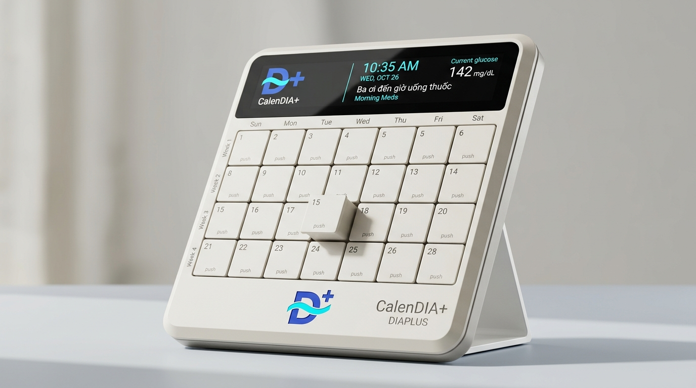
*(Mô hình CalenDIA+ hoàn thiện nhận diện thương hiệu DIAPLUS: Logo D+ dập nổi chân đế, hiển thị OLED thông minh, 28 ngăn kéo nhấn-nhả phẳng lì)*
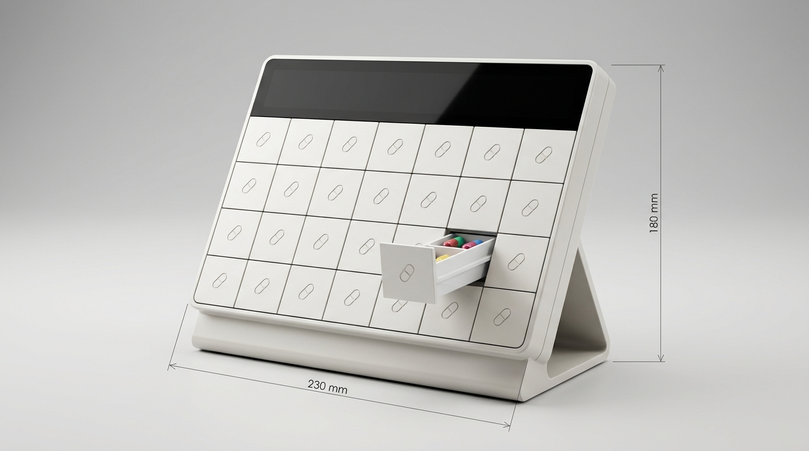
*(Mô hình CAD in 3D PETG CalenDIA+: Kích thước 230 mm × 180 mm, mặt trước phẳng lì không tay nắm, 1 ngăn kéo búng thò ra ngoài 20 mm sau khi nhấn nhẹ)*

```
◄─────────────────────────── W = 230.0 mm ───────────────────────────►
┌───────────────────────────────────────────────────────────────────┐ ── Part 1 (Front Bezel)
│  ╭─────────────────────────────────────────────────────────────╮  │ 
│  │   DIA+ 142 mg/dL  •  BA ƠI ĐẾN GIỜ UỐNG THUỐC (OLED Display)│  │ ── Part 5 (OLED Bezel)
│  ╰─────────────────────────────────────────────────────────────╯  │
│    T.HAI    T.BA     T.TƯ    T.NĂM    T.SÁU    T.BẢY     CN       │ 
│   ┌─────┐  ┌─────┐  ┌─────┐  ┌─────┐  ┌─────┐  ┌─────┐  ┌─────┐   │ 
│SÁNG [  ●  ]  [  ●  ]   [  ●  ]   [  ●  ]   [  ●  ]   [  ●  ]   [  ●  ]   │
│   ├─────┤  ├─────┤  ├─────┤  ├─────┤  ├─────┤  ├─────┤  ├─────┤   │
│TRƯA [  ●  ]  [  ●  ]   [  ●  ]   [  ●  ]   [  ●  ]   [  ●  ]   [  ●  ]   │ ── Part 2 (28 Ngăn kéo)
│   ├─────┤  ├─────┤  ├─────┤  ├─────┤  ├─────┤  ├─────┤  ├─────┤   │    + Cơ chế Heart-Cam
│CHIỀU[  ●  ]  [  ●  ]   [  ●  ]   [  ●  ]   [  ●  ]   [  ●  ]   [  ●  ]   │    + Lò xo nén Inox
│   ├─────┤  ├─────┤  ├─────┤  ├─────┤  ├─────┤  ├─────┤  ├─────┤   │
│TỐI  [  ●  ]  [  ●  ]   [  ●  ]   [  ●  ]   [  ●  ]   [  ●  ]   [  ●  ]   │
│   └─────┘  └─────┘  └─────┘  └─────┘  └─────┘  └─────┘  └─────┘   │
└───────────────────────────────────────────────────────────────────┘
         \                                                   /
          \═════════════════════════════════════════════════/ ──── Part 7 (Chân đế nghiêng 75°)
           ◄─────────────── D_base = 120.0 mm ─────────────►
```

* **Chiều rộng tổng thể (W):** **230.0 mm** (Vừa khít bàn in 3D phổ thông $235 \times 235\text{ mm}$ hoặc $256 \times 256\text{ mm}$).
* **Chiều cao tổng thể (H):** **180.0 mm** (Tính từ chân đế đến mép đỉnh).
* **Chiều sâu tổng thể (D):** **120.0 mm** (Thân máy nghiêng dày $42.0\text{ mm}$ + Chân đế xòe sau tạo góc đứng ổn định chống lật khi ấn khay).
* **Góc nghiêng mặt bảng điều khiển:** **$75^\circ$ so với phương nằm ngang** (Góc nhìn công thái học tối ưu khi ngồi bàn hoặc nằm giường).
* **Độ dày thành vỏ nhựa tiêu chuẩn (t):** **$2.2\text{ mm} - 2.5\text{ mm}$** (Đảm bảo độ cứng vững khi in FDM).

---

## 3. Nguyên Lý Cơ Chế Nhấn-Nhả Búng Mở (Push-to-Open Mechanism)

Cơ chế hoạt động hoàn toàn bằng **cơ học thuần túy (Mechanical Push-Push / Heart-Cam Latch)**, không tiêu tốn điện năng, không cần motor hay solenoid, độ bền trên 100.000 lần nhấn.

```
       MẶT CẮT CƠ HỌC BÊN TRONG CỦA 1 NGĂN KÉO PUSH-TO-OPEN:

               Lò xo nén Inox 304 (Part 9)
               (Ø 4.0mm x L 25mm)
                       │
                       ▼ 
    ┌──────────┐     ┌───┐     ┌───────────────────────────────┐
    │          ├─────┤▓▓▓├─────┤ Khay đựng thuốc Part 2        │  ◄─── Ấn nhẹ 2mm (Push)
    │ Khung    │     └───┘     │                               │
    │ dẫn      │               │                               ├──┐ ◄─ Mặt trước phẳng lì
    │ hướng    │    ╭───────╮  │                               │  │    (Flush Sealed Face)
    │ Part 3   ├───┤ Que    ├──┤ Rãnh tim Heart-Cam đúc liền   │  │
    │          │   │ chốt gạt  │ sườn hông ngăn kéo           ├──┘
    └──────────┘   ╰───────╯   └───────────────────────────────┘
```

### Chu Trình Hoạt Động 4 Bước:
1. **Trạng thái đóng phẳng lì (Locked State):** Khay thuốc nằm thụt phẳng lì ngang mặt vỏ máy Part 1. Lò xo nén phía sau bị nén lại, que chốt thép nằm gọn trong hõm khóa của rãnh tim (Heart-Cam Pocket). Khe hở mặt trước chỉ $0.4\text{ mm}$ khép kín hoàn toàn.
2. **Thao tác nhấn vào (Push In $2.0\text{ mm}$):** Người dùng dùng 1 ngón tay ấn nhẹ vào mặt khay $2\text{ mm}$. Que chốt thép trượt theo đường dốc dẫn hướng thoát khỏi hõm khóa tim.
3. **Búng mở (Pop-Out $20.0\text{ mm}$):** Lực bung tự do của lò xo nén Inox đẩy khay thuốc búng trượt thò ra ngoài $20\text{ mm}$ kèm tiếng "CÁCH" giòn tan.
4. **Rút thuốc & Đóng lại (Retrieval & Lock):**
   * Khi khay đã thò ra $20\text{ mm}$, $2$ bên thành khay lộ ra điểm tì tay rất rộng, người dùng kẹp ngón tay rút khay ra lấy thuốc thoải mái.
   * Uống xong, chỉ cần đẩy nhẹ khay vào trong, que chốt thép tự rơi vào hõm khóa, khay nằm phẳng lì trở lại.

---

## 4. Thông Số Kỹ Thuật Chi Tiết 8 Chi Tiết Cơ Khí (Part-by-Part CAD Specs)

---

### PART [1]: Khung Vỏ Mặt Trước & Ma Trận Cửa Sổ (Front Bezel & Matrix Faceplate)

#### Bản Vẽ Mô Hình 3D CAD & Bản Vẽ Kỹ Thuật Bóc Tách Chi Tiết:
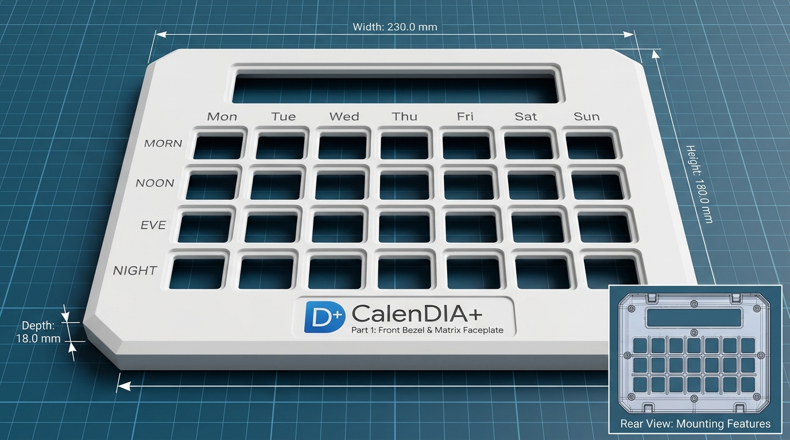
*(Mô hình 3D CAD Khung vỏ mặt trước CalenDIA+: Kích thước 230 × 180 × 18 mm, cửa sổ hiển thị OLED đỉnh, 28 cửa sổ ma trận 7×4, mặt vát chân đế in logo D+ CalenDIA+, mặt sau có 8 trụ ren M3)*

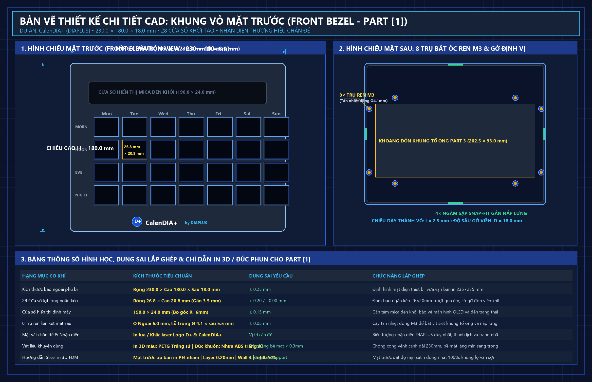
*(Bản vẽ bóc tách hình chiếu đứng, hình chiếu mặt sau với 8 trụ ren M3 và bảng thông số dung sai gia công cho Part 1)*

* **Chức năng:** Định hình diện mạo mặt trước thiết bị, định vị cửa sổ hiển thị OLED/dải đèn trạng thái đỉnh máy, tạo 28 cửa sổ bao bọc phẳng khít cho 28 ngăn kéo thuốc, khắc nhãn ngày/buổi công thái học, hiển thị nhận diện thương hiệu DIAPLUS duy nhất ở chân đế và liên kết toàn bộ khung máy.
* **Kích thước ngoài phủ bì:** **Rộng 230.0 mm × Cao 180.0 mm × Dày 18.0 mm** (Bo viền 4 góc ngoài bán kính cong mềm mại $R = 8.0	ext{ mm}$, vừa khít bàn in 3D FDM phổ thông $235 	imes 235	ext{ mm}$).
* **Kết cấu chi tiết:**
  * **Cửa sổ hiển thị đỉnh máy:** Kích thước lọt lòng **$190.0	ext{ mm} 	imes 24.0	ext{ mm}$** (bo góc $R = 6.0	ext{ mm}$), có gờ bậc chìm đón vừa tấm mica/PMMA đen khói bảo vệ màn hình OLED và đèn báo.
  * **Ma trận 28 cửa sổ ngăn kéo:**
    * 7 cột × 4 hàng. Kích thước lọt lòng mỗi cửa sổ: **Rộng 26.8 mm × Cao 20.8 mm** (khe hở $0.4	ext{ mm}$ mỗi chiều so với ngăn kéo $26.0 	imes 20.0	ext{ mm}$ giúp khay trượt qua nhẹ nhàng).
    * Bề dày gân ngăn cách giữa các ô: **$3.5	ext{ mm}$** cứng vững.
    * Chu vi mép trong từng cửa sổ có **gờ bậc chìm (Recess Step)** sâu $1.2	ext{ mm}$, rộng $1.0	ext{ mm}$ để đón mép bích chắn bụi của ngăn kéo Part 2 ép khít vào khi đóng, che kín 100% bụi bẩn.
  * **Chữ dập nổi / khắc chìm sắc nét:**
    * Tiêu đề thứ trong tuần: `Mon`, `Tue`, `Wed`, `Thu`, `Fri`, `Sat`, `Sun` (hoặc `T.HAI` ... `CN`) dập sâu $0.6	ext{ mm}$.
    * Cột buổi trong ngày: `MORN`, `NOON`, `EVE`, `NIGHT` (hoặc `SÁNG`, `TRƯA`, `CHIỀU`, `TỐI`) dập sâu $0.6	ext{ mm}$.
  * **Mặt vát chân đế (Front Stand Chin):** Mặt phẳng nghiêng $75^\circ$ đặt duy nhất biểu tượng Logo `D+` màu Royal Blue với dải lượn sóng Cyan và tên sản phẩm `CalenDIA+` sang trọng, trang nhã.
  * **Kết cấu liên kết mặt sau (Rear Architecture):**
    * Khoang rỗng âm đón vừa vặn cụm Khung tổ ong Part 3 kích thước $202.5 	imes 93.0	ext{ mm}$.
    * **8 Trụ ren M3 đúc nổi:** Đường kính ngoài $arnothing 6.0	ext{ mm}$, lỗ trong $arnothing 4.1	ext{ mm} 	imes$ sâu $5.5	ext{ mm}$ cấy tán nhiệt đồng ren trong M3 để bắt vít siết chặt khung tổ ong và nắp lưng.
    * **4 Ngàm sập định vị (Snap-fit tabs):** Phân bố ở 4 cạnh để gài khớp nhanh với nắp lưng trước khi siết ốc.
* **Vật liệu & Hướng dẫn gia công:**
  * **In 3D FDM:** Nhựa **PETG màu Trắng sứ (Porcelain White)**. Đặt **mặt trước úp trực tiếp xuống bàn in PEI nhám mờ (Textured PEI)** để sau khi bóc ra, bề mặt đạt độ mịn satin mờ sang trọng, không lộ vân sợi, độ phẳng $<0.3	ext{ mm}$.
  * **Đúc phun hàng loạt:** Nhựa **ABS màu trắng ngọc trai** bóng nhẹ hoặc mờ mịn.

---

### PART [2]: 28 Ngăn Kéo Kín Khít Tích Hợp Rãnh Tim Push-to-Open (Sealed Drawers)

#### Bản Vẽ 3D & Sơ Đồ Kích Thước Bóc Tách 1 Ngăn Kéo & Hốc Thuốc:
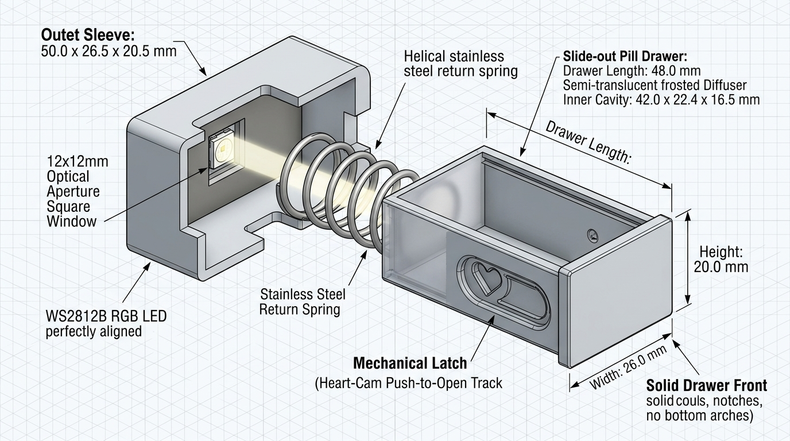
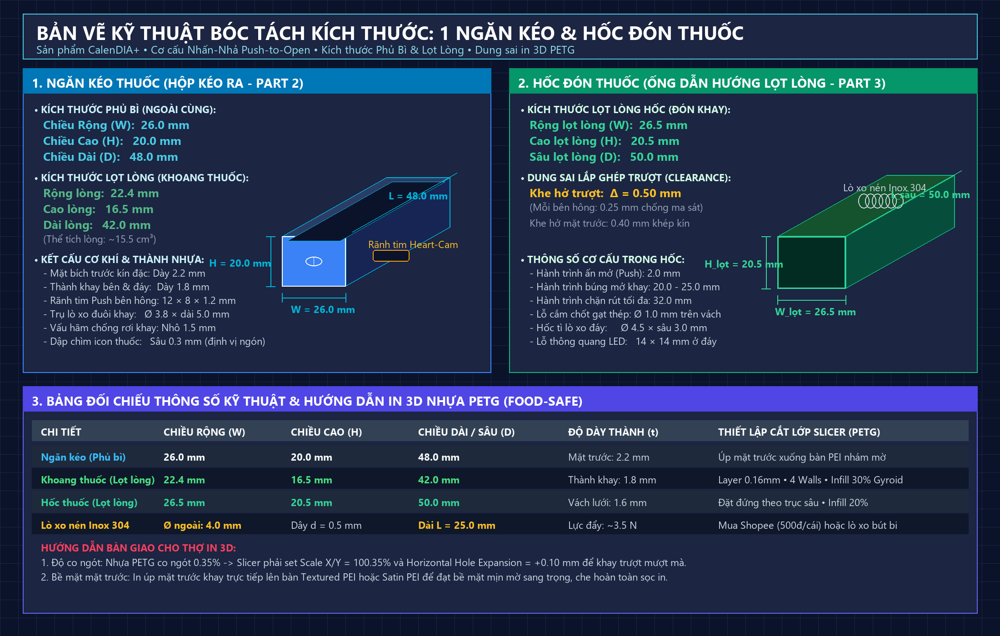
*(Bản vẽ bóc tách độc lập 1 ngăn: Chiều Rộng 26.0 mm, Chiều Cao 20.0 mm, Chiều Dài 48.0 mm; Hốc lọt lòng: 26.5 × 20.5 × 50.0 mm)*

* **Số lượng:** 28 chiếc giống nhau.
* **Kích thước phủ bì:** Rộng 26.0 mm × Cao 20.0 mm × Dài (Sâu) 48.0 mm.
* **Kích thước lọt lòng khoang thuốc:** Rộng 22.4 mm × Dài 42.0 mm × Sâu 16.5 mm (thể tích $15.5\text{ cm}^3$, chứa thoải mái 6-8 viên nang lớn cỡ 00).
* **Kết cấu cơ khí đặc biệt:**
  * **Mặt trước phẳng lì 100% (Solid Flush Face):** Tấm nhựa kín đặc dày 2.2 mm, bo viền 4 góc bán kính $R = 1.5\text{ mm}$. Ở chính giữa có dập chìm biểu tượng viên thuốc mini hoặc vòng tròn tactile $\varnothing 6\text{ mm}$ sâu $0.3\text{ mm}$ để định vị ngón tay nhấn.
  * **Rãnh tim Heart-Cam đúc liền:** Nằm ở mặt ngoài của thành bên hông phải khay. Kích thước rãnh tim $12.0\text{ mm} \times 8.0\text{ mm} \times$ sâu $1.2\text{ mm}$, có đảo tim nhô lên $0.8\text{ mm}$ và dốc nhảy 1 chiều (Step-down ramp) để que chốt thép chỉ chạy theo 1 chiều khép kín.
  * **Hốc giữ lò xo nén ở đuôi khay:** Trụ định vị lò xo Ø 3.8 mm nhô ra 5.0 mm ở chính giữa mặt sau để lồng lò xo nén Inox Ø 4.0 mm không bị tuột.
  * **Vấu cản hành trình (Pull-out Stopper Tab):** Cao 1.5 mm ở cạnh trên đuôi khay, chạm gờ Part 3 khi kéo ra hết $32\text{ mm}$ tránh rơi khay xuống đất.

---

### PART [3]: Khung Xương Tổ Ong Dẫn Hướng Nguyên Khối (Monolithic Honeycomb Core Guide Grid)

#### Bản Vẽ Mô Hình 3D CAD & Bản Vẽ Kỹ Thuật Bóc Tách Chi Tiết:
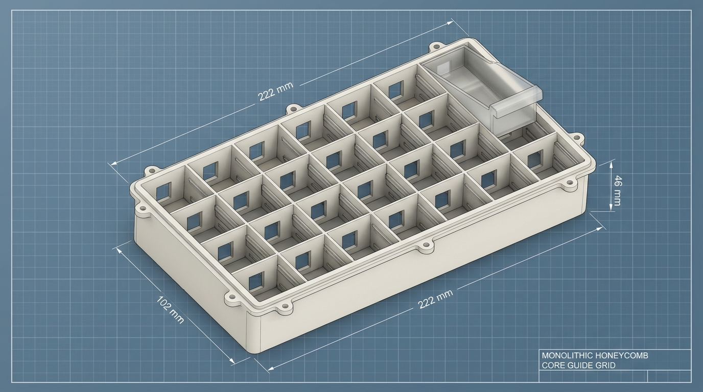
*(Mô hình 3D CAD Khung xương tổ ong nguyên khối 7x4 = 28 hộc dẫn hướng, kích thước 222 × 102 × 46 mm, tích hợp rãnh trượt âm, vách chắn sáng quang học và cửa sổ xuyên sáng LED)*

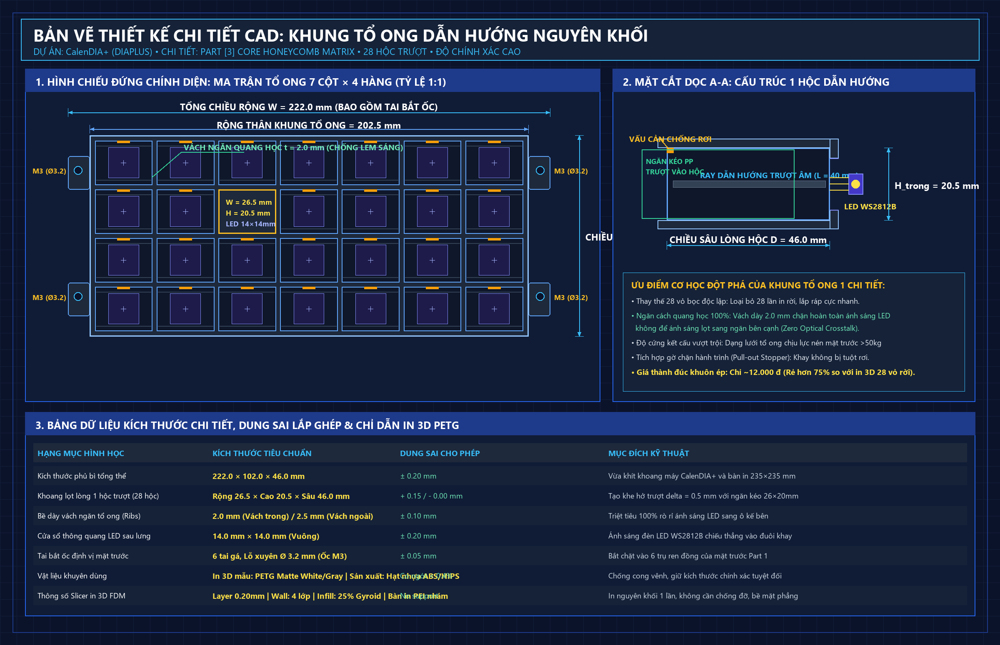
*(Bản vẽ bóc tách hình chiếu đứng, mặt cắt dọc A-A và bảng dung sai lắp ghép chi tiết của Khung tổ ong Part 3)*

* **Chức năng:** Khung xương chịu lực trung tâm (Core Backbone), tích hợp liền khối ma trận 28 hộc dẫn hướng trượt độc lập cho 28 ngăn kéo, cách ly quang học chống lem sáng giữa các ngăn, chịu lực ấn tì tay từ mặt trước và liên kết vững chắc vỏ máy.
* **Kích thước ngoài phủ bì:** **Rộng 222.0 mm × Cao 102.0 mm × Sâu 46.0 mm** (Phù hợp hoàn hảo với bàn in 3D FDM $235 \times 235\text{ mm}$ phổ thông).
* **Kết cấu chi tiết:**
  * **28 Khoang trượt chữ nhật lọt lòng:** **Rộng 26.5 mm × Cao 20.5 mm × Sâu 46.0 mm** (khe hở trượt $\Delta = 0.5\text{ mm}$, mỗi bên $0.25\text{ mm}$ so với ngăn kéo $26.0 \times 20.0\text{ mm}$, trượt siêu êm không rung lắc).
  * **Vách ngăn quang học tổ ong (Optical Isolation Ribs):** Độ dày **$t = 2.0\text{ mm}$** (vách trong) và **$t = 2.5\text{ mm}$** (thành ngoài). Vách kín đặc 100% giúp triệt tiêu hiện tượng lem sáng (*Optical Crosstalk*), đảm bảo khi 1 ngăn bật đèn LED báo uống thuốc thì các ô bên cạnh hoàn toàn tối đen.
  * **Cửa sổ xuyên quang sau lưng:** 28 lỗ vuông kích thước **$14.0\text{ mm} \times 14.0\text{ mm}$** ở đáy mỗi hộc, cho phép luồng ánh sáng LED WS2812B chiếu thẳng trực tiếp vào đuôi ngăn kéo PP mờ.
  * **Ray dẫn hướng trượt âm & Gờ chặn hành trình (Pull-out Stopper):**
    * 2 ray dẫn hướng dày $0.8\text{ mm} \times 1.0\text{ mm}$ chạy dọc chiều sâu thành bên của từng hộc.
    * Gờ chặn nhô cao $1.2\text{ mm}$ ở mép trước phía trên đón đầu vấu cản của ngăn kéo, ngăn khay thuốc bị tuột rơi ra ngoài khi người dùng rút nhanh.
  * **Tai gá định vị (Mounting Flanges):** 6 tai bắt ốc gia cường với lỗ xuyên **$\varnothing 3.2\text{ mm}$** (bắt vít Inox M3) liên kết chặt chẽ vào các trụ ren đồng của mặt trước Part 1.
* **Vật liệu gia công:**
  * **In 3D FDM làm mẫu:** Nhựa **PETG** màu Trắng sứ hoặc Xám kỹ thuật (Độ co ngót $<0.4\%$, chịu lực nén $>50\text{ kg}$, không cong vênh).
  * **Sản xuất khuôn đúc hàng loạt:** Nhựa **ABS/HIPS** nguyên sinh gia cường (Chi phí ép đúc chỉ ~12.000đ/khung).
* **Thông số Slicer in 3D FDM:** Chiều cao lớp $0.20\text{ mm}$, 4 lớp thành vỏ (Perimeters), ruột in $25\%\text{ Gyroid}$, đặt nằm phẳng úp mặt đáy xuống bàn in PEI nhám, **hoàn toàn không cần tạo Support**.

---

### PART [4]: Khay Gá 28 Lò Xo Nén & Dải Đèn LED (Spring Base & LED Isolation Tray)

* **Chức năng:** Chịu lực đẩy của 28 lò xo nén Inox và cách ly ánh sáng tuyệt đối giữa 28 mắt đèn LED WS2812B.
* **Kích thước:** Rộng 220.0 mm × Cao 100.0 mm × Dày 10.0 mm.
* **Kết cấu:**
  * 28 hốc tròn Ø 4.5 mm × sâu 3.0 mm để tì giữ chặt đầu còn lại của 28 lò xo nén Inox.
  * 28 hốc chữ nhật $12 \times 12\text{ mm}$ đặt vừa mắt LED 5050 WS2812B, có rãnh luồn dây nối tiếp 3 dây (+5V, DATA, GND).
* **Vật liệu in:** Khuyến nghị in bằng PETG màu đen hoặc sơn đen lòng hốc để chống lọt sáng 100%.

---

### PART [5]: Mặt Nạ Màn Hình OLED & Kính Bảo Vệ (OLED Bezel Bracket)

* **Chức năng:** Cố định màn hình OLED 0.96 inch hoặc 1.3 inch I2C phẳng khít với mặt kính ngoài.
* **Kích thước:** Rộng 67.4 mm × Cao 21.4 mm × Dày 4.5 mm.
* **Vật liệu:** Mica đen khói cắt laser hoặc in PETG màu đen bóng.

---

### PART [6]: Vỏ Ốp Lưng Khoang Điện Tử (Rear Housing Chassis)

#### Bản Vẽ Bóc Tách 3 Tầng & Vị Trí Gắn Chip ESP32-C3 Chi Tiết:
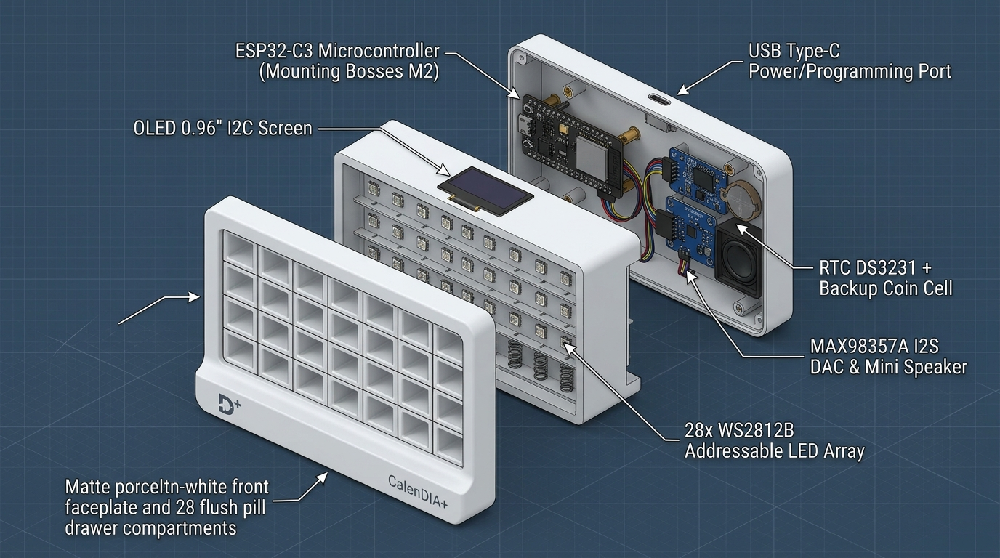
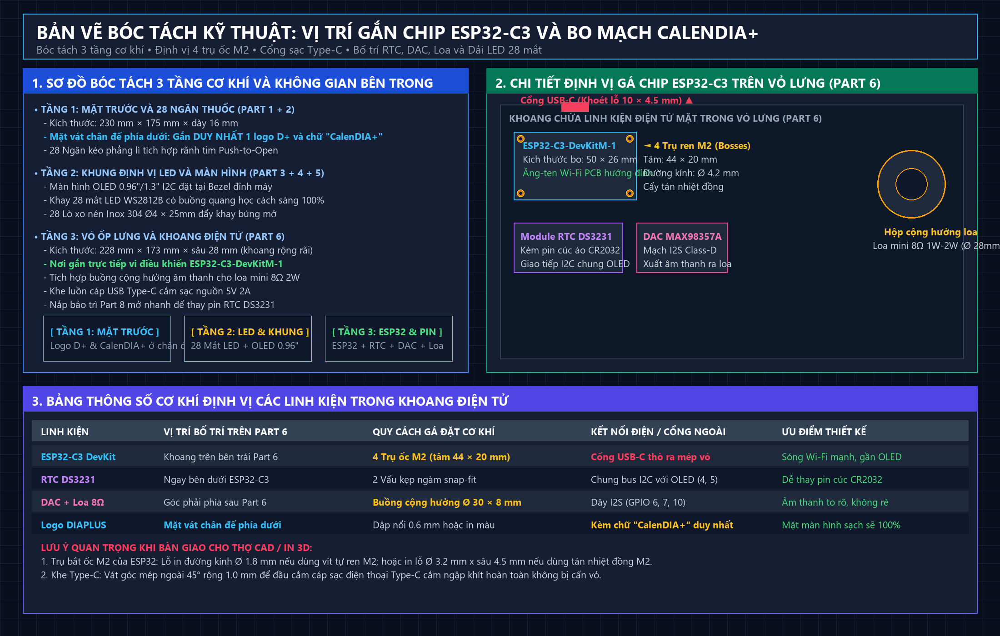
*(Sơ đồ bóc tách 3 tầng: Tầng 1 mặt trước có logo D+ & CalenDIA+; Tầng 2 khung LED; Tầng 3 khoang gắn chip ESP32-C3 với 4 trụ ốc M2 và cổng Type-C)*

* **Chức năng:** Đóng kín mặt sau, chứa toàn bộ cụm mạch điện tử và khoang cộng hưởng loa.
* **Kích thước ngoài:** Rộng 228.0 mm × Cao 173.0 mm × Sâu 28.0 mm.
* **Bố trí khoang bên trong & Vị trí gắn Chip ESP32-C3:**
  * **Hốc gá vi điều khiển ESP32-C3-DevKitM-1:**
    * Vị trí: Đặt ở góc trên bên trái của vỏ lưng (ngay dưới màn hình OLED, cách mép trên 15 mm).
    * Kết cấu gá: **4 Trụ bắt ốc M2 (Screw Bosses)** có tâm lỗ cách nhau **$44.0\text{ mm} \times 20.0\text{ mm}$**. Đường kính trụ Ø 4.2 mm, lỗ lõi Ø 1.8 mm (dùng vít tự ren M2 hoặc cấy tán nhiệt đồng M2).
    * Cổng nạp/cấp nguồn **USB Type-C**: Khoét lỗ oval $10.0\text{ mm} \times 4.5\text{ mm}$ ở mép trên hoặc sườn vỏ lưng để cắm cáp sạc 5V 2A từ củ sạc.
  * **Hốc gá module RTC DS3231:** Nằm ngay dưới bo mạch ESP32-C3 ($40 \times 24\text{ mm}$), có 2 vấu ngàm bấm giữ chặt pin cúc áo CR2032.
  * **Hốc gá mạch giải mã âm thanh MAX98357A:** Kích thước $22 \times 20\text{ mm}$ nằm cạnh RTC.
  * **Buồng cộng hưởng âm thanh độc lập cho Loa:** Hốc tròn Ø 30.0 mm × sâu 8.0 mm cho loa mini $8\Omega$ 1W-2W, dán viền kín khí và có nan hoa thoát âm mặt sau.
  * Lỗ nút bấm xác nhận/tắt chuông Ø 12.5 mm ở đỉnh máy.

---

### PART [7]: Chân Đế Để Bàn Nghiêng 75° Chống Lật (Desktop Base Stand)

* **Chức năng:** Giá đỡ chịu lực toàn bộ máy, tạo góc nghiêng $75^\circ$ cố định vững chắc, giúp máy không bị trượt lùi khi người dùng ấn mở khay.
* **Kích thước phủ bì:** Rộng 210.0 mm × Sâu 120.0 mm × Dày 12.0 mm (chân đế mở rộng về sau).
* **Mặt đáy:** Có 6 hốc tròn Ø 10.0 mm × sâu 1.2 mm để dán chân đệm cao su silicon hoặc giác hút chống trượt.

---

### PART [8]: Nắp Bảo Trì Bo Mạch (Service Door)

* **Chức năng:** Cửa mở nhanh mặt hông kích thước $52 \times 65\text{ mm}$ để thay pin cúc áo RTC DS3231 hoặc nạp firmware qua cổng Type-C mà không cần mở toàn bộ vỏ máy.

---

### PHỤ KIỆN CƠ KHÍ MUA SẴN [PART 9] (Hardware Accessories)

| Tên phụ kiện | Số lượng | Kích thước kỹ thuật | Ghi chú / Nơi mua |
| :--- | :---: | :--- | :--- |
| **Lò xo nén Inox 304** | 28 cái | Đường kính ngoài Ø 4.0 mm, Dài $L = 25.0\text{ mm}$, Dây $d = 0.5\text{ mm}$ | Mua trên Shopee (~500đ/cái) hoặc lò xo bút bi |
| **Que chốt thép chữ U** | 28 cái | Dây thép đàn hồi Ø 0.8 mm, Chiều dài duỗi $12.0\text{ mm}$ | Uốn từ ghim giấy Inox hoặc dây thép piano |
| **Tán nhiệt đồng M3 (Heat-set)** | 12 hạt | Ren trong M3, Ø ngoài 4.2 mm, Chiều dài $5.0\text{ mm}$ | Ép nhiệt vào các trụ bắt ốc |
| **Ốc lục giác chìm Inox M3** | 12 con | M3 × 12 mm | Bắt cố định thân vỏ và chân đế |
| **Đệm cao su silicon chân đế** | 6 miếng | Tròn Ø 10 mm × dày 1.5 mm (có sẵn keo 3M) | Dán mặt đáy chân đế chống trượt |

---

## 5. Hướng Dẫn Kỹ Thuật In 3D FDM Nhựa PETG (Dành Cho Xưởng In)

Nhựa **PETG** là vật liệu bắt buộc cho chi tiết này nhờ tính dẻo dai, không bị giòn gãy như PLA, chịu nhiệt tốt và không thôi nhiễm hóa chất độc hại vào thuốc.

### Bảng Thiết Lập Thông Số Cắt Lớp (Slicer Settings):

| Tên chi tiết | Hướng đặt trên bàn in | Chiều cao lớp (Layer Height) | Thành vỏ (Walls) | Mật độ ruột (Infill) | Hỗ trợ (Support) |
| :--- | :--- | :---: | :---: | :---: | :---: |
| **PART [1] (Mặt trước)** | Mặt trước úp xuống bàn in PEI phẳng | 0.20 mm | 4 lớp | 25% Gyroid | Không cần |
| **PART [2] (28 Ngăn kéo)** | **Mặt trước úp xuống bàn PEI mịn** | **0.16 mm** | **4 lớp** | **30% Gyroid** | Không cần |
| **PART [3] (Khung lưới)** | Đặt đứng theo chiều trục sâu | 0.20 mm | 3 lớp | 20% Grid | Không cần |
| **PART [4] (Khay lò xo)** | Đặt nằm phẳng | 0.20 mm | 4 lớp | 30% Gyroid | Không cần |
| **PART [6] (Vỏ lưng)** | Mặt lưng úp xuống bàn in | 0.20 mm | 4 lớp | 25% Gyroid | Support góc cổng sạc |
| **PART [7] (Chân đế)** | Đáy chân đế úp xuống bàn in | 0.20 mm | 5 lớp | **40% Gyroid** | Không cần |

### Lưu Ý Quan Trọng Để Bề Mặt Sang Trọng Như Đúc Khuôn:
1. **Mặt trước ngăn kéo Part 2 & Mặt trước vỏ Part 1:** Bắt buộc đặt **úp trực tiếp xuống mặt bàn in PEI nhám mờ (Textured PEI) hoặc Satin PEI**. Khi bóc chi tiết ra, toàn bộ mặt trước sẽ có độ mịn mờ ánh satin đồng nhất, phẳng lì không thấy bất kỳ đường sọc đùn nhựa nào, đẹp như sản phẩm đúc công nghiệp.
2. **Nhiệt độ in:** Đầu phun $235^\circ\text{C} - 240^\circ\text{C}$, Bàn in $75^\circ\text{C} - 80^\circ\text{C}$.
3. **Bù co ngót trục X/Y:** Thiết lập hệ số `Horizontal Hole Expansion = +0.1 mm` và `Scale X/Y = 100.35%` để đảm bảo khay trượt nhẹ nhàng, không bị kích ma sát.

---

## 6. Sơ Đồ Đấu Nối 11 Linh Kiện Điện Tử (Đồng Bộ Mã Nguồn ESP32-C3)

Toàn bộ 11 linh kiện trong danh mục bạn mua được đấu nối theo chuẩn tối ưu chân GPIO:

```
┌────────────────────────────────────────────────────────────────────────────────┐
│                             ESP32-C3-DevKitM-1                                 │
├─────────────────┬──────────────────────────────────┬───────────────────────────┤
│ Chân ESP32-C3   │ Linh kiện kết nối                │ Chuẩn giao tiếp           │
├─────────────────┼──────────────────────────────────┼───────────────────────────┤
│ GPIO 4 (SDA)    │ Màn hình OLED + RTC DS3231       │ Chung đường truyền I2C    │
│ GPIO 5 (SCL)    │ Màn hình OLED + RTC DS3231       │ Chung đường truyền I2C    │
│ GPIO 8 (DATA)   │ Dải LED WS2812B (28 mắt)         │ Chuỗi tín hiệu Digital    │
│ GPIO 7 (BCLK)   │ Mạch DAC I2S MAX98357A           │ Bit Clock Audio           │
│ GPIO 6 (LRC)    │ Mạch DAC I2S MAX98357A           │ Left/Right Clock Word     │
│ GPIO 10 (DIN)   │ Mạch DAC I2S MAX98357A           │ Data In Audio             │
│ GPIO 9 (PULLUP) │ Nút bấm Tactile switch           │ Nút tắt chuông/xác nhận   │
│ 5V / VBUS       │ Nguồn cấp LED, DAC, Type-C       │ Nguồn 5V DC từ Củ sạc 2A  │
│ 3.3V            │ Cấp nguồn OLED, RTC DS3231       │ Nguồn 3.3V ổn định từ MCU │
│ GND             │ Nối chung toàn bộ Mass thiết bị  │ Ground                    │
└─────────────────┴──────────────────────────────────┴───────────────────────────┘
```

---

## 7. Trình Tự Lắp Ráp Hoàn Thiện (8 Bước)

1. **Bước 1 (Xử lý chi tiết in 3D):** Bóc bavia chân in của 28 ngăn kéo Part 2 và khung Part 3. Lấy giấy ráp mịn P800 xoa nhẹ 2 bên gân trượt.
2. **Bước 2 (Lắp cụm cơ khí Push-to-Open):**
   * Cắm 28 que chốt thép chữ U vào các lỗ bản lề của khung lưới Part 3.
   * Lắp 28 lò xo nén Inox vào 28 hốc định vị của khay Part 4.
   * Đặt khay Part 4 áp sát sau khung Part 3.
3. **Bước 3 (Thử nghiệm cơ cấu búng):** Trượt thử từng ngăn kéo Part 2 vào khoang; ấn nhẹ nghe tiếng "CÁCH" khóa lại; ấn nhẹ lần nữa khay tự động búng thò ra ngoài $20\text{ mm}$ mượt mà.
4. **Bước 4 (Cụm quang học):** Cắt 28 mắt LED WS2812B, hàn nối dây mềm, dán cố định vào khay Part 4. Gắn màn hình OLED vào Bezel Part 5.
5. **Bước 5 (Gắn vào mặt trước):** Áp cụm khung ma trận vào mặt sau Part 1, siết 6 ốc vít M3 vào các tán đồng ép nhiệt.
6. **Bước 6 (Cụm điện tử):** Cố định bo mạch ESP32-C3, RTC DS3231, MAX98357A và dán kín loa $8\Omega$ vào buồng cộng hưởng trên vỏ lưng Part 6. Cắm toàn bộ dây Dupont theo bảng pinout Mục 6.
7. **Bước 7 (Đóng vỏ máy):** Áp vỏ lưng Part 6 vào mặt trước Part 1, siết 8 ốc lục giác chìm M3×12 mm.
8. **Bước 8 (Lắp chân đế):** Bắt 4 ốc M3 gắn chân đế Part 7 vào đáy máy, dán 6 đệm cao su chống trượt. Cắm nguồn sạc Type-C kiểm tra đèn LED và âm thanh nhắc nhở.

---

## 8. Phiên Bản Tối Ưu Hóa Dòng Tiền BOM Đúc Phun Hàng Loạt (CalenDIA+ DFM Cost-Down Edition)

Dựa trên bảng phân tích tối ưu hóa chi phí sản xuất hàng loạt (Design for Manufacturing - DFM) và cắt giảm dòng tiền BOM, CalenDIA+ được tinh chỉnh kiến trúc cơ khí và điện tử để đạt mức **giá vốn COGS chỉ từ 146.000đ - 178.000đ**, cho phép định giá bán lẻ thương mại trên Shopee từ **299.000đ - 399.000đ** với **biên lợi nhuận gộp đạt 51% - 55%**.

### 8.1. Bản Vẽ Mô Hình 3D Thực Tế Tối Ưu Hóa DFM (CalenDIA+ Cost-Down Edition):
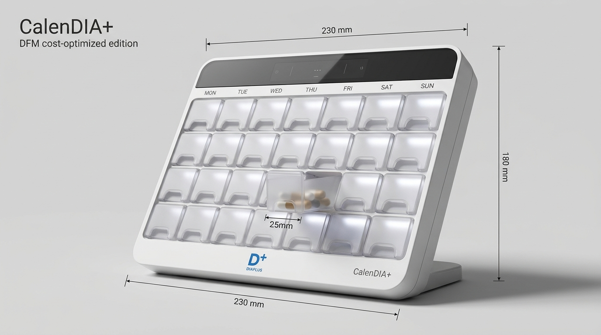
*(Mô hình CalenDIA+ DFM: 28 ngăn kéo nhựa PP mờ công thái học có rãnh tì ngón tay, ánh sáng LED xuyên sáng dịu mắt, khung tổ ong nguyên khối, vát chân đế duy nhất 1 logo D+ và chữ CalenDIA+ thanh lịch)*

### 8.2. Bản Vẽ Bóc Tách Kỹ Thuật & Cấu Trúc Giá Vốn 3 Tầng:
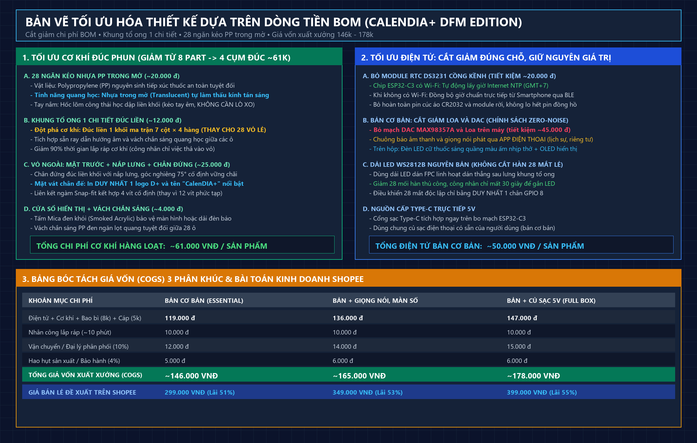
*(Bản vẽ phân rã 4 chi tiết cơ khí đúc phun ~61.000đ, tối ưu cắt giảm mạch điện tử và ma trận giá vốn 3 phân khúc)*

---

### 8.3. Bóc Tách 4 Cụm Cơ Khí Đúc Phun Nguyên Khối (Tổng ~61.000đ)

Thay vì in 3D nhiều mảnh rời và lắp 28 bộ lò xo/que chốt phức tạp, phiên bản đúc phun hàng loạt chuyển sang giải pháp cơ khí tinh gọn thông minh:

| STT | Chi tiết khuôn ép nhựa | Vật liệu | Đơn giá ước tính | Giải pháp kỹ thuật tối ưu chi phí |
| :---: | :--- | :--- | :---: | :--- |
| **1** | **28 Ngăn kéo độc lập** | **Nhựa PP trong mờ (Frosted PP)** | **~20.000đ** *(~714đ/khay)* | • Nhựa PP thực phẩm (Food-grade) tiếp xúc thuốc an toàn tuyệt đối.<br>• Bề mặt làm mờ nhám cát giúp tán xạ ánh sáng LED dịu mắt, **loại bỏ thấu kính gom sáng rời**.<br>• Mặt trước dập lõm **rãnh công thái học (Finger Scoop)** giúp rút khay êm ái, **loại bỏ 28 bộ lò xo và lẫy bấm tốn kém** (~14.000đ phụ kiện). |
| **2** | **Khung xương tổ ong (Core Honeycomb Grid)** | **Nhựa ABS/HIPS gia cường** | **~12.000đ** | • Đúc liền 1 khối ma trận $7 \times 4 = 28$ hộc dẫn hướng.<br>• Thay thế hoàn toàn 28 vỏ bọc độc lập, **giảm 90% thời gian nhân công lắp ráp**.<br>• Tích hợp sẵn vách ngăn quang học triệt tiêu 100% hiện tượng lem sáng giữa các ngăn. |
| **3** | **Mặt trước + Nắp lưng + Chân đứng** | **Nhựa ABS màu trắng sứ** | **~25.000đ** | • Thiết kế vỏ Unibody ngàm sập (Snap-fit) thông minh kết hợp 4 ốc vít M3 cố định.<br>• Chân đế tích hợp góc nghiêng công thái học $75^\circ$.<br>• Vát chân đế in lụa / khắc laser duy nhất logo `D+` và thương hiệu `CalenDIA+` sang trọng. |
| **4** | **Cửa sổ hiển thị + Vách chắn sáng** | **Mica/PMMA đen khói (Smoked Acrylic)** | **~4.000đ** | • Mặt nạ đen bóng giấu mạch LED hiển thị trạng thái.<br>• Tích hợp khe chắn bụi và vách gom luồng ánh sáng. |
| **TỔNG** | **Toàn bộ cơ khí đúc phun (4 cụm)** | — | **~61.000đ** | **Rẻ hơn 68% so với phương pháp in 3D gia công thủ công.** |

---

### 8.4. Chiến Lược Tối Ưu Hóa Mạch Điện Tử (Electronics Cost-Down)

1. **Cắt giảm DAC âm thanh rời & Loa ngoài (Tiết kiệm ~45.000đ):**
   * Trong phiên bản tiêu chuẩn giá rẻ, còi báo và giọng nói nhắc nhở được chuyển giao hoàn toàn sang **App di động CalenDIA+ trên điện thoại** (thông báo đẩy Push Notification + giọng đọc tiếng Việt qua loa điện thoại).
   * Vừa giảm chi phí phần cứng, vừa tuân thủ triết lý **"Zero-Noise Office"** (không gây ồn ào bất ngờ khi đặt thiết bị ở văn phòng làm việc hay phòng khách).
2. **Cắt giảm mạch pin thời gian thực RTC DS3231 (Tiết kiệm ~20.000đ):**
   * Vi điều khiển **ESP32-C3** có sẵn Wi-Fi và Bluetooth LE. Thiết bị tự động đồng bộ giờ nguyên tử (NTP Clock Sync) qua mạng Wi-Fi gia đình hoặc qua kết nối Bluetooth mỗi khi điện thoại người dùng lại gần.
3. **Mảng LED WS2812B thông minh tối giản:**
   * Sử dụng 28 bóng LED RGB SMD dán trực tiếp trên 1 dải FPC uốn dẻo, chỉ cần 1 chân dữ liệu GPIO điều khiển toàn bộ ma trận.

---

### 8.5. Ma Trận Giá Vốn (COGS) & Kịch Bản Kinh Doanh Thương Mại

| Thành phần cấu thành chi phí | Bản Cơ Bản (App Sync) | Bản + Giọng Nói & Màn Số | Bản Full Box (+ Sạc 5V) |
| :--- | :---: | :---: | :---: |
| **Linh kiện điện tử + Cơ khí + Bao bì (8k) + Cáp (5k)** | 119.000đ | 136.000đ | 147.000đ |
| **Nhân công lắp ráp dây chuyền (~10 phút)** | 10.000đ | 10.000đ | 10.000đ |
| **Chi phí vận chuyển lưu kho / Đại lý phân phối (10%)** | 12.000đ | 14.000đ | 15.000đ |
| **Dự phòng rủi ro / Hao hụt bảo hành (4%)** | 5.000đ | 6.000đ | 6.000đ |
| **TỔNG GIÁ VỐN HÀNG BÁN (COGS)** | **~146.000đ** | **~165.000đ** | **~178.000đ** |
| **GIÁ BÁN LẺ DỰ KIẾN (SHOPEE / TIKTOK SHOP)** | **299.000đ** | **349.000đ** | **399.000đ** |
| **LỢI NHUẬN GỘP / MỖI SẢN PHẨM** | **153.000đ (51.2%)** | **184.000đ (52.7%)** | **221.000đ (55.4%)** |

