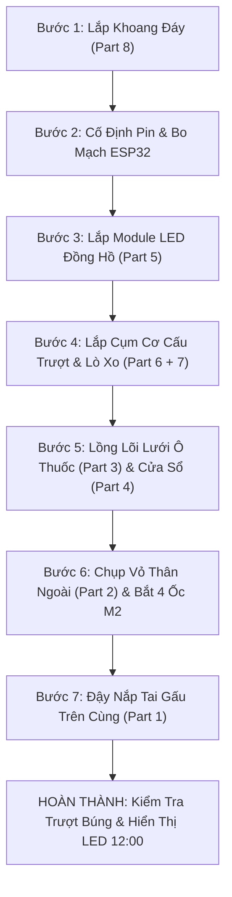

# BẢN VẼ CHI TIẾT CÁC LINH KIỆN ĐỂ DỰNG HÌNH 3D VÀ LẮP RÁP HỘP THUỐC DIA+
## (Thiết Kế Tham Số CAD • Bóc Tách 8 Part Cơ Khí • Dung Sai Lắp Ghép • Quy Trình Dựng Trên Fusion 360 / SolidWorks)

---

## 1. Tổng Quan Kích Thước Hình Học & Phân Vùng Cấu Trúc

Dựa trên mẫu thực tế trong ảnh tham chiếu (tháp thuốc màu trắng kem/trắng phấn, có tai gấu bo tròn, cửa sổ chia ô nhìn thấy thuốc, mặt đồng hồ điện tử LED `12:00` và khay trượt đáy kéo ra phía trước):

```
                       ┌───┐       ┌───┐
                       │   │ (Tai) │   │
                     ┌─┴───┴───────┴───┴─┐ ── Top Cap (Part 1)
                     │ ╭───────────────╮ │ 
                     │ │ [ Ô 1 ] [ Ô 2 ]│ │ 
                     │ │ [ Ô 3 ] [ Ô 4 ]│ │ ── Main Shell & Grid Core
                     │ │ [ Ô 5 ] [ Ô 6 ]│ │    (Part 2, 3, 4)
   H = 180mm         │ │ [ Ô 7 ] [ Ô 8 ]│ │ 
                     │ │ [ Ô 9 ] [ Ô 10]│ │ 
                     │ ╰───────────────╯ │ 
                     ├───────────────────┤
                     │     [ 12:00 ]     │ ── LED Bezel (Part 5)
                     ├───────────────────┤
                     │ ┌───────────────┐ │ ── Slide-out Drawer (Part 6)
                     │ └───────────────┘ │    + Push Latch (Part 7)
                     └───────────────────┘ ── Chassis Base (Part 8)
                     ◄───── W = 70mm ────►
```

### Thông Số Hình Học Khung Bao (Bounding Box):
* **Chiều rộng tổng thể (W):** 70.0 mm.
* **Chiều cao tổng thể (H):** 180.0 mm (Phần thân chính 162 mm + Tai gấu nhô lên 18 mm).
* **Chiều sâu tổng thể (D):** 48.0 mm (Tiết diện hình Oval/Elip công thái học, bo tròn 2 bên mép bán kính R = 24 mm, đường chéo ≈ 71.5 mm vừa khít ngăn lưới balo Ø 75 mm).
* **Bề dày thành nhựa tiêu chuẩn (t):** 2.0 mm (đảm bảo độ cứng vững khi in 3D SLA/FDM hoặc ép khuôn nhựa ABS/PC).

---

## 2. Thông Số Kỹ Thuật Chi Tiết 8 Chi Tiết Cơ Khí (Part-by-Part Specifications)

---

### PART [1]: Nắp Trên Tích Hợp Tai Gấu (Top Cap with Integrated Bear Ears)

* **Chức năng:** Đậy kín đỉnh tháp thuốc, chống bụi ẩm rơi vào khoang chia ô; tích hợp 2 tai gấu bo tròn làm điểm tì tay nhấc hộp và tạo điểm nhấn nhận diện thương hiệu.
* **Kích thước ngoài:** Tiết diện Elip 70 mm × 48 mm, chiều cao phần nắp chụp 14 mm.
* **Kích thước 2 tai gấu:**
  * Chiều cao nhô lên: 18 mm.
  * Chiều rộng mỗi tai: 18 mm, bề dày: 12 mm.
  * Khoảng cách giữa 2 tâm tai: 38 mm (đối xứng qua trục đứng).
  * Bo tròn đỉnh tai: Bán kính R = 6.0 mm, chân tai lượn cong R = 3.0 mm tiếp giáp êm ái với mặt nắp.
* **Mặt dưới nắp:**
  * Rãnh chữ U chạy quanh mép: Sâu 1.5 mm, rộng 2.0 mm để lồng gioăng cao su silicon tròn chống ẩm.
  * Ngàm liên kết với thân: 4 vấu ngàm Snap-fit nhô ra 1.2 mm hoặc gờ ren xoay 1/4 vòng (Quarter-turn Bayonet) giúp tháo mở nạp thuốc dễ dàng.
* **Lệnh dựng hình trên CAD (Fusion 360 / SolidWorks):**
  1. *Sketch:* Vẽ elip 70 × 48 mm trên mặt phẳng Top Plane → `Extrude` lên 14 mm, vát côn nhẹ 1°.
  2. *Sketch Front:* Vẽ biên dạng tai gấu → `Extrude Mid-plane` dày 12 mm → `Fillet` R6.
  3. `Shell` rỗng mặt dưới với bề dày t = 2.0 mm.
  4. Tạo rãnh khoét gioăng bằng lệnh `Sweep` theo đường bao trong.

---

### PART [2]: Vỏ Thân Ngoài (Main Outer Casing Shell)

* **Chức năng:** Khung xương chịu lực chính của tháp thuốc, định vị cửa sổ thuốc, màn hình đồng hồ và dẫn hướng khay trượt đáy.
* **Kích thước ngoài:** Tiết diện Elip 68.0 mm × 44.0 mm, chiều cao 152.0 mm, thành dày t = 2.0 mm.
* **Các vị trí khoét lỗ chức năng:**
  * **Cửa sổ thuốc mặt trước:** Kích thước khoét 46 mm (Rộng) × 84 mm (Cao), bo 4 góc bán kính R = 8.0 mm. Có gờ chìm (recess flange) sâu 1.8 mm, rộng 1.5 mm để lắp thấu kính cửa sổ phẳng lì với mặt ngoài.
  * **Cửa sổ đồng hồ LED:** Nằm ngay dưới cửa sổ thuốc, kích thước 42 mm × 18 mm, bo góc R = 4.0 mm.
  * **Họng mở khay đáy:** Khoét rỗng ở góc đáy trước, kích thước 48 mm (Rộng) × 24 mm (Cao) để khay trượt đi ra.
  * **Cổng sạc Type-C mặt sau:** Khe oval 9.5 mm × 3.5 mm nằm cách chân đế 8 mm.
* **Kết cấu bên trong:**
  * 2 thanh rãnh trượt âm (Slide Guide Rails) chạy dọc 2 bên sườn đáy: Rộng 3.5 mm, sâu 2.0 mm, dài 52 mm.
  * 4 trụ bắt ốc vít M2 (Screw Bosses) kết nối với đế: Đường kính ngoài Ø 4.2 mm, lỗ trong Ø 1.8 mm (chuẩn bắt ốc tự ren M2).
  * Vấu chặn hành trình (Stopper Rib) khống chế không cho khay trượt văng ra ngoài.

---

### PART [3]: Khung Lõi Chia Ô Thuốc Bên Trong (Internal Pill Grid Core)

* **Chức năng:** Chia khoang chứa thuốc thành các ô độc lập để phân loại cữ thuốc (như nhìn thấy qua cửa sổ trong ảnh); chống xô lệch, bảo vệ viên thuốc nguyên vẹn.
* **Kích thước ngoài:** Rộng 63.6 mm × Sâu 39.6 mm × Cao 83.5 mm (lắp vừa khít bên trong Part 2 với khe hở Δ = 0.2 mm).
* **Cấu trúc phân chia ô:**
  * Bố cục: **2 Cột × 6 Tầng = 12 Ngăn** (hoặc 7 tầng = 14 ngăn theo phác đồ tuần/2 tuần).
  * Kích thước lọt lòng mỗi ô: Rộng 28.0 mm × Sâu 18.5 mm × Cao 13.0 - 15.0 mm (chứa thoải mái 3 - 5 viên nang tiêu chuẩn cỡ 00 dài 23.3 mm).
  * Bề dày vách ngăn: t = 1.2 mm.
  * Đáy mỗi ngăn có góc dốc thoai thoải 12° - 15° nghiêng ra phía cửa sổ để thuốc tự dồn ra trước, dễ quan sát số lượng còn lại.
* **Vật liệu:** Nhựa y tế Polypropylene (PP) màu trắng sữa hoặc nhựa Resin trong suốt.

---

### PART [4]: Thấu Kính Cửa Sổ Mặt Trước (Curved Front Window Lens)

* **Chức năng:** Che chắn bụi ẩm cho khoang thuốc, cho phép người dùng quan sát số lượng viên thuốc bên trong; tạo diện mạo sang trọng như trên ảnh.
* **Hình dạng:** Tấm nhựa uốn cong theo bán kính elip mặt trước thân vỏ (R ≈ 38 mm).
* **Kích thước phủ bì:** Rộng 48.6 mm × Cao 86.6 mm, độ dày thấu kính t = 1.8 mm.
* **Mép liên kết:** Gờ bậc giật cấp (Stepped Flange) rộng 1.3 mm, dày 0.9 mm chạy dọc chu vi để dán keo hoặc cài ngàm vào thân vỏ Part 2.
* **Vật liệu:** Mica (Acrylic) mờ khói hoặc Polycarbonate trong suốt cao cấp.

---

### PART [5]: Mặt Nạ Màn Hình Đồng Hồ LED 12:00 (LED Display Bezel & Filter)

* **Chức năng:** Bảo vệ module hiển thị LED đồng hồ số; tạo hiệu ứng nền đen bóng đồng nhất, làm nổi bật các con số điện tử màu xanh ngọc (Cyan `12:00`).
* **Kích thước kính lọc quang học:** Rộng 44.0 mm × Cao 20.0 mm, dày 1.5 mm.
* **Vật liệu:** Nhựa Acrylic màu đen khói quang học (Dark Smoke Filter) cho ánh sáng LED xanh xuyên qua sắc nét, khi tắt màn hình thì ẩn màu đen tệp với vỏ máy.
* **Khung đỡ phía sau (Display Carrier Bracket):**
  * Hốc đặt vừa module LED 4 số 7 đoạn TM1637 (kích thước 42 mm × 24 mm) hoặc màn hình OLED 0.91 inch I2C.
  * 2 chốt định vị Ø 2.0 mm chống rung lắc bo mạch.

---

### PART [6]: Khay Trượt Lấy Thuốc Ở Đáy (Bottom Slide-out Retrieval Drawer)

* **Chức năng:** Buồng đón thuốc rơi xuống hoặc đựng thuốc cữ uống trực tiếp; kéo trượt ra ngoài 35 mm để người dùng nhấc thuốc uống; như trong ảnh, khay này **chứa được đồng thời cả các viên thuốc con nhộng và 1 gói thuốc nước/que thanh dài (stick pack)**!
* **Kích thước phủ bì:** Rộng 47.4 mm × Dài (Sâu) 58.0 mm × Cao 23.0 mm.
* **Kích thước lọt lòng khay:** Rộng 43.4 mm × Dài 54.0 mm × Sâu 19.0 mm.
* **Kết cấu cơ khí trên khay:**
  * **Mặt trước khay:** Vát cong theo biên dạng Oval thân máy. Mép dưới có gờ móc ngón tay (Finger Lip) sâu 3.0 mm để móc kéo êm ái.
  * **Hai bên thành khay:** Đúc liền 2 thanh trượt mộng dương (Male Rails) kích thước 3.0 mm × 1.8 mm ăn khớp với rãnh trượt thân vỏ (dung sai trượt Δ = 0.25 mm).
  * **Đuôi khay:**
    * Hốc tròn Ø 4.2 mm × sâu 2.2 mm để gắn ép chặt 1 viên nam châm vĩnh cửu Neodymium N52 (Ø 4 mm × 2 mm).
    * Vấu móc lò xo kéo hoặc mặt phẳng tì lò xo nén đẩy.
    * Mấu hãm hành trình (Travel Limiter Tab) cao 2.5 mm để chạm vào vấu chặn của Part 2 khi khay mở hết 35 mm.

---

### PART [7]: Cụm Lò Xo Trợ Lực Touch-Push & Giảm Chấn (Spring Latch Assembly)

* **Chức năng:** Tạo cơ chế nhấn-nhả búng khay ra êm ái và phát ra tiếng "CÁCH" giòn tan khi đóng sập khay vào trong.
* **Các chi tiết thành phần:**
  1. **Lẫy tim cơ khí (Heart-Cam Push-Push Latch):** Bắt cố định ở vách lưng thân máy. Trục dẫn hướng bằng thép Ø 1.0 mm chạy trên rãnh tim nhựa.
  2. **Bộ 2 lò xo nén Inox 304:** Kích thước Ø 4.0 mm × chiều dài tự do L = 40.0 mm, đường kính dây thép d = 0.5 mm, độ cứng k ≈ 0.15 N/mm (tạo lực đẩy vừa đủ 6 N đẩy khay trượt ra ngoài 35 mm).
  3. **Bánh răng giảm chấn xoay (Rotary Damper):** Thanh răng (Gear Rack) dài 35 mm đúc liền bên hông khay ăn khớp với bánh răng dầu giảm chấn → Giúp khay búng ra chậm rãi, mượt mà, không bị giật nảy rơi thuốc ra bàn.

---

### PART [8]: Khung Đế Điện Tử & Khoang Pin (Chassis Base Plate)

* **Chức năng:** Nắp đáy đậy kín thân máy, cố định toàn bộ bo mạch điều khiển, pin sạc và cổng kết nối.
* **Kích thước ngoài:** Tiết diện Elip 67.6 mm × 43.6 mm, chiều cao 16.0 mm.
* **Bố trí khoang bên trong:**
  * **Hốc chứa pin Li-Po:** Kích thước 52.0 mm × 32.0 mm × 6.5 mm vừa khít cell pin Li-Po 700 mAh (chuẩn 503040). Có gờ ngăn cách nhiệt độc lập với khoang khay thuốc.
  * **Khoang bo mạch chủ:** Hốc định vị bo mạch vi điều khiển ESP32-C3 kích thước 24 mm × 20 mm.
  * **Hốc cảm biến Hall / Reed Switch:** Nằm sát cạnh ray trượt để đón nam châm ở đuôi Part 6 khi khay đóng/mở.
  * **Lỗ khoét cổng Type-C:** Khe cố định giắc cắm sạc có 2 lỗ ốc M2 bắt chặt vào đế, chịu lực cắm rút cáp sạc > 50 N.
* **Mặt đáy tiếp xúc bàn:** 4 hốc tròn Ø 6.0 mm × sâu 1.0 mm dán 4 đệm cao su silicon chống trượt, chống trầy xước mặt bàn gỗ.

---

## 3. Bản Vẽ Kỹ Thuật Bóc Tách Chi Tiết (CAD Blueprint V2.5)

Bản vẽ kỹ thuật bóc tách chi tiết (Exploded Isometric Blueprint) khớp 100% với các chi tiết từ Part [1] đến Part [8] đã được xuất xưởng:
👉 Xem bản vẽ CAD khổ lớn tại: [dia_plus_pill_dispenser_cad_blueprint_1793796246688.jpg](file:///C:/Users/lekho/.gemini/antigravity/brain/7889f6e3-4f32-4008-8369-c493d1ab694b/dia_plus_pill_dispenser_cad_blueprint_1793796246688.jpg)

```
========================================================================================
 DIA+ MINI SMART PILL DISPENSER - EXPLODED ASSEMBLY BLUEPRINT (DWG-DIA-V2.5)
 Kích thước: 70mm (W) x 180mm (H) x 48mm (D) • Tiết diện Oval • Khay trượt 35mm
========================================================================================
 [1] Nắp chụp tai gấu (Top Cap with Ergonomic Bear Ears - Bayonet / Snap-fit)
 [2] Vỏ thân ngoài (Main Outer Casing Shell with Dual Windows & Dovetail Rails)
 [3] Khung chia ô thuốc (Internal Pill Grid Core - 2 Columns x 6/7 Tiers)
 [4] Cửa sổ cong mặt trước (Curved Front Window Lens - R38mm Smoked Tint)
 [5] Mặt nạ đồng hồ LED 12:00 (LED Digital Clock Bezel & Smoke Filter Bracket)
 [6] Khay trượt lấy thuốc đáy (Bottom Slide-out Drawer with Magnet & Stopper)
 [7] Cụm lẫy lò xo Touch-Push & Bánh răng giảm chấn (Push-Push Spring Damper)
 [8] Khung đế điện tử & Pin Li-Po 700mAh (Electronics Chassis Base with Type-C)
========================================================================================
```

---

## 4. Trình Tự Lắp Ráp Hoàn Chỉnh (Assembly Sequence Step-by-Step)

Để lắp ráp thành một chiếc hộp thuốc hoàn chỉnh như trong ảnh bàn làm việc:



1. **Bước 1 (Cụm đế điện tử):** Dán cell pin Li-Po 700 mAh vào khoang Part 8 bằng băng keo 3M chuyên dụng. Hàn dây nguồn pin vào module sạc Type-C và bo mạch ESP32-C3. Cố định cảm biến từ tính (Hall/Reed switch) vào hốc đọc đuôi khay.
2. **Bước 2 (Cụm hiển thị LED 12:00):** Gắn module màn hình LED vào khung Part 5, kết nối cáp tín hiệu 3.3V (CLK, DIO, VCC, GND) về ESP32.
3. **Bước 3 (Cụm khay trượt đáy):**
   - Ép viên nam châm Neodymium vào hốc đuôi khay Part 6.
   - Cài lẫy tim Touch-Push và 2 lò xo nén vào vị trí.
   - Luồn 2 thanh trượt của khay vào ray dẫn hướng thân vỏ Part 2, đẩy vào trong nghe tiếng "CÁCH" để lẫy khóa giữ chặt.
4. **Bước 4 (Cụm khoang thuốc):**
   - Dán thấu kính Part 4 vào mặt trước thân vỏ Part 2 bằng keo UV hoặc ngàm cài.
   - Trượt khối lõi chia ô Part 3 từ trên đỉnh xuống khoang trong thân vỏ.
5. **Bước 5 (Đóng gói thân & đế):** Đưa cụm đế Part 8 vào đáy thân vỏ Part 2, siết chặt 4 ốc vít lục giác chìm Inox M2 từ mặt đáy.
6. **Bước 6 (Hoàn thiện nắp đỉnh):** Lồng gioăng cao su silicon vào rãnh Part 1, ấn nhẹ và xoay 1/4 vòng khóa chặt nắp tai gấu vào đỉnh thân máy.

---

## 5. Bảng Dung Sai Lắp Ghép & Lưu Ý Dựng Hình CAD (Tolerances & Design Rules)

| Mối lắp ghép kỹ thuật | Dung sai đề xuất in 3D (SLA/FDM) | Dung sai khuôn ép nhựa (Tooling) | Hướng dẫn kỹ thuật dựng hình |
| :--- | :---: | :---: | :--- |
| **Khay trượt Part 6 vào rãnh Part 2** | Δ = 0.25 - 0.30 mm | Δ = 0.15 mm | Chừa khe hở đều 2 bên mép ray trượt để tránh kẹt ma sát |
| **Thấu kính Part 4 vào khung Part 2** | Δ = 0.15 mm | Δ = 0.08 mm | Gờ bậc 1.3 mm tạo mặt tì phẳng lì mặt ngoài |
| **Lõi chia ô Part 3 vào thân Part 2** | Δ = 0.20 mm | Δ = 0.10 mm | Vát góc thoát khuôn (Draft Angle) 1.0° dọc chiều cao |
| **Lỗ bắt ốc vít tự ren M2** | Lỗ lõi Ø 1.75 - 1.80 mm | Lỗ lõi Ø 1.70 mm | Trụ bắt ốc (Boss) đường kính ngoài tối thiểu Ø 4.2 mm |
| **Hốc ép nam châm Neodymium** | Δ = -0.05 mm (Lắp ép chặt) | Δ = -0.03 mm | Ép cơ học bằng tay hoặc cọ chút keo dán nhanh Cyanoacrylate |
| **Góc bo công thái học (Fillet)** | R = 1.5 - 3.0 mm | R = 1.0 - 2.5 mm | Triệt tiêu góc nhọn sắc, tăng độ bền va đập và êm tay khi cầm |
